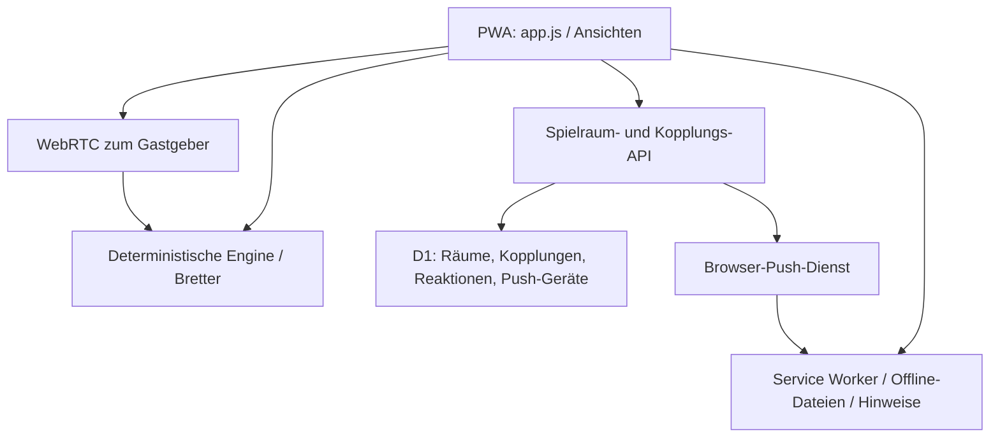

# Architektur

<!-- farbfeld-version: 1.17.3 -->

## Farbabschlussanzeige

Farbabschlüsse bleiben mit Spielername und Farbe während der gesamten Partie sichtbar, auch nach weiteren Würfen, Blattwechsel und Wiederaufnahme. Die Anzeige liest alle gespeicherten bestätigten Abschlüsse ohne Rundengrenze. Minen entfernen verlorene Abschlüsse und aktualisieren übertragene Farbprämien bereits in der gemeinsamen Engine; die Karten übernehmen diesen aktuellen Stand. Im verdeckten Spiel bleiben Prämienwerte und fremde Blätter verborgen. Kein zusätzlicher Timer, Push, Datenabruf oder neues Speicherformat.

## Gemeinsame UI-Bausteine

`style.css` definiert gemeinsame `--status-*`-Tokens für Flächen, Konturen, kleine Symbolfelder und semantische Akzente. Minen, Bonusfelder, Farbabschluss, Punkte und Ergebnis bleiben dadurch über alle sechs Designs konsistent. Die Brettfarben und der dunkle aktuelle Spieler bleiben funktional unterscheidbar. `game-info.js` formatiert Farbabschluss-Grammatik nach der vorhandenen Verdeckungsprojektion; `bonus-ui.js` rendert kompakte Prämien und nativen Details-Verlauf aus ausschließlich gewerteten Bonusereignissen. Kein neuer Spielzustand, Transport, Timer oder Push-Ereignistyp. [UI-Vertrag](ui-design.md).

## Neu 1.17.0: Bonusfelder, Random und gemeinsame Minen

Drei geheime **Bonusfelder** vergeben je +2 an alle ersten Finder desselben Wurfs; Bekanntgabe erst nach der gemeinsamen Wertung, Punkte bleiben trotz Minen erhalten. **Random** erzeugt bei jedem neuen Start ein gemeinsames, gespeichert fortsetzbares Brett. Die optionale **Mine** trifft ein gewähltes Zielfeld bei allen aktiven Gegnern, einmal pro Person für insgesamt fünf Punkte. Die Explosion dauert drei Sekunden; Schadensmarkierungen bleiben bis Ende des nächsten Wurfs. Leere Ziele verursachen beim jeweiligen Gegner keinerlei Schaden.

**Partie verlassen** gibt sofort einen einmaligen Verlaufseintrag mit −10 Punkten und Niederlage. Die anderen spielen weiter; die letzte aktive Person gewinnt sofort. Im Internet wandert die Gastgeberrolle weiter. Offline bleibt das ursprüngliche Gastgeber-Handy als Zuschauer und Verbindung geöffnet; Verbindungsverlust pausiert sicher, ohne neue Autorität zu erfinden. Alle beteiligten Apps für neue Regeln auf 1.17.0 aktualisieren. [Bonusfelder](bonus-fields.md) · [Minen](mines.md) · [Random](random-board.md) · [Aussteigen](leaving.md).

## Neu 1.16.0: Offline-Testprotokoll und optionale Computer-Minen

Ein freiwilliges lokales A/B-Testprotokoll hilft bei Offline-Kopplung und Spielabgleich; es ist aus Einstellungen und Kopplungsdialogen exportierbar. [Testanleitung und Datenschema](offline-diagnostics.md). Die neue Startoption **Minenangriff testen** wurde in 1.16.0 zunächst gegen den Computer erprobt; ab 1.17.0 gilt sie für alle Mehrspielerarten: gegnerischer Farbabschluss schaltet einen einmaligen Angriff für fünf Punkte frei. Ein leeres Zielfeld ist ein vollständiger Fehlschlag ohne Nachbarschaden. Nach einem Treffer gehen Erstboni sofort an den verbleibenden vollständigen Halter; ohne Halter werden sie erneut frei. Wiedervervollständigen bei bestehendem Halter erhält den Späterbonus. [Regeln, verdeckte Zielwahl und Wertung](mines.md).

## Revanche-Ereignis 1.15.0

Nur der bestätigte Host-Rematch hinterlegt die alte Spielkennung in der Lobby. Der folgende Start übernimmt `rematchOf` und `rematchBy` in die neue Partie. Die gemeinsame Policy erzeugt für wartende andere Mitglieder `gameId:rematch`; eigene Züge haben Vorrang. Neue Worker melden `rematch-push-v1` authentifiziert in Registrierung/Präsenz, D1 merkt nur das boolesche `rematch_ready` (Migration 0009). Alte Geräte erhalten keine unbekannte Art. Aufgeschobene Startaufträge benutzen dieselbe Outbox und Wartung; konkrete Eventprüfung akzeptiert sie nur bis zur ersten eigenen Auswahl in Wurf 1. Ein bereits angenommener erster Zug macht den Startauftrag überflüssig. Keine freie Nachrichten-API, Timer, neue Secrets oder Backend-Lesezugriffe auf Nutzerblätter.

## Zustellverlauf und Wiederherstellung ab 1.14.0

**Push-Status prüfen** lädt zusätzlich die letzten höchstens zwanzig Versände dieses Geräts. Sie zeigen Ereignisart, Zeit, Versuchszahl und Provider-/Browserstatus; nach einem registrierten Antippen außerdem den Klick. Die Daten enthalten keine Namen, Punkte, Abonnements oder Geheimnisse. Eine Browserquittung bestätigt weiterhin kein menschliches Lesen oder eine sichtbare Sperrbildschirmdarstellung.

Neue automatische Hinweise werden vor der Antwort an die spielende Person als eigener Auftrag gespeichert. Bis zu drei kurze Versuche laufen nach dem gespeicherten Spielzug; insgesamt höchstens vier. Erneut versucht werden nur Netzwerk-/Zeitfehler, HTTP 429/5xx oder ausdrücklich quittierte Prüf-/Anzeigefehler vor einer Anzeige. Retry-After wird eingehalten. Eine Providerannahme ohne Browserquittung führt nicht zum erneuten Versand. Vor jedem Versuch gewinnen ein überholter Zug, entfernter Zugang, abgeschaltete Hinweise, ersetztes Abonnement oder Ablauf. Testmeldungen behalten ihren einmaligen Versand und ihre Minute Frist.

Der feste Wartungsaufruf **POST /api/notifications/maintenance** mit leerem JSON-Objekt kann ausschließlich solche gespeicherten Aufträge wiederaufnehmen; keine Ziele oder Inhalte lassen sich angeben. Eine globale Minuten-Lease und höchstens zwölf Aufträge pro Lauf begrenzen ihn. Ein vom jeweiligen Betreiber eingerichteter regelmäßiger Check kann als Rückfallebene für abgebrochene oder länger aufgeschobene Versuche dienen; er ist keine Zusage sekundengenauer Zustellung. Auch normale neue Spielaktionen nehmen fällige Arbeit auf. Die PWA erhält keine Hintergrund-Abfrageschleife. GET derselben Route zeigt nur Bereitschaft und Zeitpunkt des letzten Wartungslaufs. Ob die Aufgabe tatsächlich eingerichtet ist, steht im Deployment.

Der Service Worker darf die aktuelle Gelegenheit zweimal mit jeweils fünf Sekunden Frist prüfen, nur innerhalb des einzelnen Push-Ereignisses. Er zeigt bei nicht verifizierbarem Zustand keinen alten Hinweis. Eine Anzeige-Reservierung verhindert konkurrierende Anzeigen; erst erfolgreicher showNotification-Aufruf setzt „verarbeitet“ und das Minutenlimit. Ablehnung gibt die Reservierung frei. Beim Neustart wird eine vorhandene Meldung desselben Ereignisses erkannt. Eine während der Prüfung sichtbare App bleibt still.

Migration 0008 ergänzt notification_dispatches mit Geräte-/Raum-Cascade, Versuchszähler, Leasing und bereinigter Diagnose. Nicht mehr wartende Einträge werden auf zwanzig pro Gerät und sieben Tage begrenzt. Wartende Hinweise bleiben nur innerhalb ihrer 24-Stunden-Frist versendbar. Bestehende Geräte, Schlüssel, Backups und Spielregeln bleiben verwendbar; neue Worker-Funktionen benötigen das normale PWA-Update.

## Computer-Spielkopf ab 1.13.1

`gameHTML` gruppiert Zurück und Computerüberschrift in `computer-heading-row`. Im Handy-Hochformat belegt diese Gruppe eine eigene Rasterzeile, die drei Steuerungen eine weitere; der fertige Zustand nutzt zwei Spalten. Außerhalb davon ist die Gruppe mit `display: contents` transparent. Der Titeltext liegt in einem eigenen Span mit wortweisem Umbruch, das vorhandene Einstellungssymbol bleibt separat. Keine Änderung an Spielzustand, Transport oder Hintergrundarbeit.

## Computer-Stärken ab 1.13.0

`computer.js` kapselt drei Strategien bei unveränderter gemeinsamer Regelengine. Leicht ruft das bisherige findMove auf. Mittel enumeriert verbundene Gruppen und bewertet Bonusfortschritt, Anschlussmöglichkeiten und knappe Joker. Schwer betrachtet bis zu acht Kandidaten plus Passen, die Wahrscheinlichkeiten künftiger Zwei-/Dreierwürfel und bei offenen Punkten eine gegnerische Antwort einschließlich Endwertung. Keine tatsächlichen zukünftigen Würfe oder RNG-Aufrufe beim Entscheiden. Bei verdeckten Punkten wird die fremde Analyseposition vollständig neutralisiert. `computerDifficulty` ergänzt den Schema-1-Spielstand optional; fehlend bedeutet Leicht. Die Gerätepräferenz betrifft neue Partien. Stärkewechsel ersetzt nur dieses Metadatum, ohne Würfel-/Zug-/Draftänderung. Alle Module sind bereits Teil des 36-Dateien-Caches. Details: [computer.md](computer.md).

## JSON-Exportnamen ab 1.12.5

`exportData()` erzeugt den bestehenden Schema-1-Backupinhalt und den Dateinamen aus demselben erfassten Zeitpunkt. Der Name verwendet das lokale Kalenderdatum des Geräts als `YYYYMMDD_`, gefolgt von `Farbfeld` und dem Inhaltstyp: `YYYYMMDD_Farbfeld_Spielstand.json`. `exportedAt` bleibt ein ISO-Zeitpunkt. Import prüft den Inhalt, keinen bestimmten Dateinamen; alte Sicherungen bleiben kompatibel. Diese Benennung gilt auch für künftige JSON-Downloads. Keine neue Datei, Speicherung, Abhängigkeit oder API.

## Komponenten und Zuständigkeiten

`public/play.html` lädt den statischen ESM-Client. `app.js` verbindet Oberfläche und Abläufe, `view-state.js` trennt Spielerrolle und betrachtetes Blatt, `board-view.js` verwaltet Einpassen und Pinch-Zoom. `boards.js` enthält unveränderliche Brettdefinitionen; `engine.js` prüft Züge und wertet deterministisch. `computer.js` nutzt dieselbe Engine. `themes.js` enthält sechs unveränderliche gerätelokale Designs mit Namen, Symbol und Hauptüberschrift. Die ausschließlich lokal definierten Überschriftentexte markieren den Akzent mit `<em>`; dunkler Grundtext und Design-Akzent bleiben getrennt. Einstellungen zeigen kompakte Kacheln in zwei Spalten und drei Reihen; Beschreibungen bleiben als zugängliche Namen/Tooltips. Derselbe Symbolgeber liefert Spielfeldmarkierungen. Das Hunde-Design verwendet für Kachel und Markierung die lokale `paw.svg` (eine braune Pfote mit dunklem Rand); die Hero-Dekoration referenziert dieselbe Datei statt eines plattformabhängigen Emojis. Keine Theme-Metadaten im gemeinsamen Spielzustand. Die Kopfzeile und Ladeansicht verwenden stets das bereits offline gecachte `/icon.svg` als Farbfeld-Logo. Das Theme verändert weder Motiv noch Farben oder Umrandung dieses Markenzeichens.

`reactions-extra-v1` ergänzt das bestehende Emoji-Protokoll nur als Fähigkeit: 👍/😲 benötigen aktualisierte Empfänger und beim Direktspiel einen aktualisierten Gastgeber. Alte Reaktionen/gespeicherte Effekte und Direktprotokoll 2 bleiben gültig. Der Notification-Worker darf neue ersetzende Hinweise nur mit ausdrücklicher Tonwahl erneut hörbar ankündigen; alle übrigen Limits gelten davor.

Die Startseite rendert Fortsetzen-Karten in dieser Reihenfolge vor dem Hero: gespeicherte Internet-Räume, laufender lokaler Spielstand (Solo/Computer/Ein-Handy), gespeicherte Direktverbindung einschließlich Kopplung. Es werden dieselben Zustände und Aktionen verwendet; reine DOM-Reihenfolge ohne zusätzliche Netzwerkzugriffe.

## Spielzustand und Transporte

| Modus | Verbindlicher Zustand | Übertragung |
| --- | --- | --- |
| Solo, Computer, ein Handy | lokaler Client | keine |
| Internet-Spielraum | D1-Raum mit Versionsnummer | HTTP-Aktionen und Polling |
| Direktspiel | ursprüngliches Gastgeber-Handy | zuverlässige, geordnete WebRTC-Kanäle in Sternform |

Internetaktionen prüfen Spielerzugang, Rolle, Spielregeln und erwartete Raumversion. Das abschließende D1-Update ist ein Compare-and-swap. Direktaktionen tragen Protokoll, Sitzung, Aktions-ID, Spiel und Runde; der Gastgeber autorisiert den festen Kanalplatz und speichert Deduplizierungsdaten. Passive Personen dürfen im selben Wurf unabhängig bestätigen. Gespeicherte Direktstände erlauben nach nötiger erneuter Kopplung die Fortsetzung; eine alte Gastkopie überschreibt keinen neueren Gastgeberstand.

Der optionale Raumname ist Metadatum im D1-Raum-JSON, kein Bestandteil der Engine. Erstellung und `rename` normalisieren Leerraum und begrenzen auf 48 Zeichen. Nur der Gastgeber darf umbenennen oder in der Lobby über `remove` ein Mitglied entfernen; der Gastgeber selbst und laufende Spielergruppen bleiben erhalten. Entfernte Tokens autorisieren keine weiteren API-Aufrufe. Raumansichten enthalten außerdem `boardUpdateNeeded`, damit der Client veraltete Brettfähigkeiten zuordnen kann. Alle Änderungen verwenden denselben Versions-/CAS-Schutz; Code und persönliche Zugänge der übrigen Mitglieder bleiben unverändert. Eine Metadatenänderung erzeugt weder Würfel noch Push.

Ab 1.8.2 erneuert ein authentifizierter `GET /api/rooms` die explizit per `X-Farbfeld-Features` gemeldeten Fähigkeiten des aufrufenden Mitglieds. Die einmalige `hello`-Registrierung bleibt kompatibel, ist aber keine Voraussetzung für die Freigabe alter Räume. Ein fehlender Header überschreibt keine gespeicherte Registrierung; unbekannte Fähigkeiten werden ignoriert. Nur eine tatsächliche Änderung erhöht die Raumversion. Drei begrenzte CAS-Versuche lesen bei Konflikten den aktuellen Stand und die Mitgliedschaft erneut. Parallele Züge/Namen werden nicht überschrieben, entfernte Gäste nicht wieder eingesetzt. Laufende Varianten prüfen weiterhin die tatsächlichen Fähigkeiten des Clients.

`farbfeld.rooms.v1` enthält die gespeicherten Raumzugänge und begrenzte Zusammenfassungen. `farbfeld.room.v1` bleibt als kompatibler Zeiger auf den ausgewählten Raum erhalten. Beide übernehmen optional den zuletzt bestätigten Namen für die Wiederaufnahmekarte. Der Client übernimmt Namen aus autorisierten API-Antworten und gibt sie ausschließlich als escapten Text aus. Eine Umbenennung löscht keine unbestätigte Auswahl. Andere Spielarten und gespeicherte Engineformate bleiben unverändert.

QR-Daten enthalten vollständige Angebote/Antworten mit lokalen ICE-Kandidaten. Keine externen STUN-/TURN-Server. Optional vermittelt `/api/direct-pairing` einmalig per kurzlebigem Raumcode. Danach braucht der Direktmodus keine Signalisierung oder Internetverbindung. Browser/Hotspot-Isolation kann die lokale Verbindung verhindern.

## Speicherung

| Speicher | Zweck | Zugriff |
| --- | --- | --- |
| `farbfeld.stats.v1` | kompakter abgeschlossener Ergebnisverlauf / Profil, Schema 1 | dieses Gerät, im lokalen Export |
| `farbfeld.game.v1` | lokale Partie, Schema 1 | dieses Gerät |
| `farbfeld.rooms.v1` | mehrere persönliche Raumzugänge und begrenzte Zusammenfassungen | dieses Gerät, nicht im Export |
| `farbfeld.room.v1` | ausgewählter Raum und kompatibler einzelner Zugang | dieses Gerät, nicht im Export |
| `farbfeld.direct.v1` | Direktstand und persönliche Kopplungsdaten | dieses Gerät, nicht im Export |
| `farbfeld.reactions.seen.v1` | begrenzte Anzeigecursor für Raumreaktionen | dieses Gerät, außerhalb der Spielbackups |
| `farbfeld.prefs.v1`, `farbfeld.history.v1` | Design/Optionen und Ergebnisse | dieses Gerät, lokaler Export |
| Offline-Cache `farbfeld-v<Version>` | 40 statische Dateien | atomarer Service-Worker-Cache |
| IndexedDB `farbfeld.notifications.v1` | Opt-in, Gerätegeheimnis, Deduplizierung | Notification-Worker, nicht im Export |
| D1 `room_presence` | gedrosselte Rückmeldungen je Raum/Mitglied, getrennt von Zugversionen | authentifizierter Raumzugang |
| D1 `rooms` | Raumzustand, Version, letzte Nutzung und Bereinigungstermin | autorisierte Spieler-API |
| D1 `direct_pairings` | kurzlebige Kopplungsangebote/-antworten | getrennte Host-/Gastzugänge |
| D1 `room_reactions` | Emoji-Ereignisse, höchstens 24 Stunden verfügbar | authentifizierter Sender / erlaubte Empfänger |
| D1 `notification_devices` | Abonnement, primäre Zuordnung, Präsenz, Versandgrenzen und letzte begrenzte Diagnose | gehashter Gerätezugang plus Raumtoken beim Binden |
| D1 `notification_room_bindings` | mehrere bestätigte persönliche Raumzuordnungen und Ereigniscursor | eigener Gerätezugang plus jeweiliges Raumtoken |
| D1 `room_maintenance` | global begrenzte Bereinigungs-Lease | ausschließlich serverintern |

## Benachrichtigungen als Nebenwirkung

`notification-policy.js` definiert ausschließlich eigene Spielgelegenheit und Spielende. Würfeln und die folgende Auswahl sind ein Ereignis. `lib/notifications.js` prüft nach einem erfolgreichen Raum-Commit Abonnement, Vordergrund-Lease, Ereignis und Minutenlimit, prüft den aktuellen Raum erneut und erzeugt verschlüsselte, VAPID-signierte Push-Nachrichten. `waitUntil` hält die Zustellung außerhalb der Antwort auf den Spielzug. Netzwerkfehler ändern keine Spielstände. Ab 1.9.8 wartet der Push-Dienst bei fehlender Geräteverbindung bis zu 24 Stunden (`TTL: 86400`); dafür läuft auf dem Handy kein Timer. Das zusätzliche `deliveryExpiresAt` erlaubt neuen Workern verzögerte Nachrichten, während die ursprüngliche `expiresAt`-Minute sofortige Zustellung an alte Worker kompatibel erhält. Lokale Direkt-/Testmeldungen behalten ihre kurze Frist. Vor der Anzeige prüft der Worker den aktuellen authentifizierten Raum erneut; es gibt weder erneuten Anwendungsversand desselben Ereignisses noch regelmäßige Erinnerungen.

`notification-worker.js` ist ein klassisches Service-Worker-Modul, geladen über `importScripts`. Es prüft Zustimmung, sichtbare Clients, Ablauf, Deduplizierung und den aktuellen Raum, bevor eine Benachrichtigung erscheint. Offline-Direktmeldungen verwenden dieselbe lokale Ausgabelogik. `notifications.js` verbindet explizite Zustimmung, Einstellungen, Präsenz und Benachrichtigungsklicks mit dem Client.

Die Notification-Initialisierung startet erst nach gemeldeter Offline-Bereitschaft. Gleichzeitige oder bereits erfolgreiche Initialisierungen werden nicht wiederholt; ein später erfolgreicher Start entfernt einen überholten Vorbereitungsfehler. Ab 1.12.4 sendet ein unsichtbarer Start kein `clear`. Zusätzlich prüft der Worker beim Verarbeiten dieser Aktion die tatsächlichen sichtbaren Fenster, damit auch ältere Clients oder verzögert abgearbeitete Nachrichten keine ungelesene Meldung im Hintergrund entfernen. Bewusstes Ausschalten räumt weiterhin sofort auf; keine neue Netzwerkabfrage und kein neuer Timer.

Ab 1.9.3 bestätigt `GameNotifications` nur tatsächlich quittierte Raumzuordnungen und verwendet konsistente Code-/Token-Snapshots. Raumwechsel während Registrierung/Binden werden mit höchstens drei seriellen Durchläufen nachgeführt, ohne zusätzlichen Timer. Manuelle Diagnose verwendet den vorhandenen authentifizierten Status-GET und versendet nichts. Die Oberfläche unterscheidet **Geräteanzeige testen**, **Internet-Push testen** und **Push-Status prüfen**. Nur der ausdrückliche Internet-Test erzeugt eine serverseitige Testnachricht; die manuelle Statusprüfung sendet keinen Push. Erlaubte Web-Push-Nachrichten verwenden hohe Zustellpriorität bei unveränderten Zeit-/Mengenlimits; Fehlerprotokolle enthalten nur Kategorien/Statuscodes.

## Raumstatus und Akkulast

`room-status.js` enthält Frische-/Verbindungszustände, die eigene Zugbeschreibung für die Startkarte, die 24-Stunden-Regel und einen einzelnen adaptiven `RoomPollScheduler`. `lib/room-presence.js` schreibt authentifizierte Rückmeldungen höchstens alle 30 Sekunden und liest nur Status der aktuellen Raummitglieder. Dies verändert keine Raum-Zugversion, Punkte oder Push-Ereignisse. Nach 90 Sekunden ohne Rückmeldung gilt ein Mitglied als offline; bei eigener Verbindungsstörung sind fremde Angaben unbekannt. Im Direktmodus wird `DirectGame.connected(pid)` verwendet.

`lastActionAt` im Raum-JSON wird ausschließlich durch Start/Wurf/Zug/Skip erneuert. Die API bietet `canSkip` nur dem Gastgeber nach 24 Stunden an und prüft das beim Schreiben erneut. Altpartien ohne Uhr bekommen einen sicheren initialen Zeitanker. Das Heim-Polling erfasst fertige Ergebnisse anhand der tatsächlichen Mitgliedskennung, unabhängig vom aktuell sichtbaren Bildschirm.

Der adaptive Timer stoppt im Hintergrund, offline und in anderen Spielarten. Er prüft bekannte aktive Heimkarten alle 60 Sekunden, eigene Züge alle 30 Sekunden und wartende Situationen zunächst nach sechs Sekunden mit stufenweiser Verlangsamung. Fehler erhalten Backoff, Requests einen Timeout. Änderungen an Statuspunkten aktualisieren nur die Anzeige und erhalten die offene Auswahl/Zoomposition. Intervalle, Grenzen und Tests: [room-status.md](room-status.md).

Die Heimkarte rendert Raumname, darunter Code mit Mitgliederzahl und anschließend den Zugstatus. `roomHomeMeta` nutzt ausschließlich die bereits gelesene Mitgliederliste; ohne diese wird nur der Code gezeigt. Besetzungsänderungen erhöhen die bestehende Raumversion und rendern damit auch die neue Anzahl. `roomTurnHTML` formatiert ausschließlich die Anzeige; `homeRoomStatus` bleibt die Quelle der Zugberechtigung. Ein Statusschlüssel verhindert unnötigen Austausch des Status-Markups. Ein zweispaltiges CSS-Raster hält einen 44-Pixel-Pfeil rechts neben den Angaben, auch auf schmalen Ansichten. Seine visuell verborgene Beschriftung wird weiterhin beim Statuswechsel aktualisiert. Kleinere Innenabstände sparen Höhe ohne gekürzte Namen. Diese Layoutkorrektur verändert weder API-Abfragen noch Spiel-/Speicherformate.

`room-game-top`/`room-game-chrome` reservieren in schmalen bzw. kompakten Ansichten eigene Rasterbereiche für Überschrift und Steuerung. Die Überschrift fasst Titel und unmittelbar folgende Metazeile (Code und Spielerzahl) in einem gemeinsamen Rasterbereich zusammen; die Metazeile bleibt auch im Querformat sichtbar. `room-heading-row` fasst Zurück und Überschrift zusammen: im Handy-Hochformat als Flexzeile oberhalb von drei gleich breiten Steuerungsbereichen, sonst mit `display: contents` im bestehenden Kopf. Die Handyzeile enthält keine reservierten leeren Felder; ohne Abbruchknopf werden es zwei Spalten. Sichtbare Textzusätze für Punkte/Beenden sind nur im schmalen Hochformat aktiv, die zugänglichen Aktionsnamen und Bestätigungsdialoge bleiben erhalten. `gameHTML` verkürzt nur die sichtbare Bestätigung; `turnDescription` und die zugrunde liegenden Rollen bleiben unverändert, einschließlich vollständigem zugänglichem Status. `awaiting-game` kennzeichnet ausschließlich selbst bestätigte Netzwerkzüge: `diceHTML` blendet dann gesperrte Würfel aus, CSS entfernt deren festen Platzhalter. Keine neue Zustandsmaschine oder Speicherung.

## Geräteprofil

`stats.js` bereinigt minimale Ergebnisdatensätze, führt sie anhand der Spiel-ID zusammen und berechnet Siege/Serien und direkte Gegnervergleiche. `statsCategory` trennt Menschen (`local`, `room`, `direct`), Computer und Solo vor jeder Aggregation. `summarizeStats` berechnet ausschließlich den gewählten Bereich; `summarizeOpponent` liefert pro normalisiertem Gegnernamen direkte Siege/Remis/Niederlagen, eigene Punktwerte, Serien und maximal fünf jüngste Duelle. Computer und Solo beeinflussen keine Menschenbilanz. Die Profilansicht und die sichtbare Ergebnisliste filtern denselben Bereich, Wertungstexte bleiben eingeklappt. `recordResult` erfasst nur fertige Spiele mit `ownPid`; der lokale Statistikverlauf bleibt unabhängig von den 100 sichtbaren Ergebnissen. Migration alter Listen rät bei uneindeutiger eigener Rolle nicht. Profil und Gegnerzuordnung bleiben gerätelokal; Namen sind keine kontobasierten Identitäten. Schema-1-Backups ergänzen optional `statistics`, Importe führen die Daten ohne Doppelzählung zusammen. Verdeckte Spiele fließen erst nach gemeinsamer Aufdeckung ein. Details: [statistics.md](statistics.md).

## Automatische Updateprüfung

`pwa.js` prüft den aktiven atomaren Cache zuerst. Zusätzliche Prüfungen laufen bei Internet-Rückkehr, beim Sichtbarwerden (mindestens eine Minute Abstand) und alle fünf Minuten in einer sichtbaren, online gemeldeten App. Sie sind serialisiert; ein Hotspot ohne Internet kann weiter aus dem vorhandenen Cache spielen. Erst ein als vollständig bestätigter neuer Worker löst den Update-Banner aus. Netzwerkfehler erhalten bereits fertige Updates und vorhandene Offlinebereitschaft. Die Seite wird erst auf Nutzerwunsch neu geladen; eine offene Auswahl wird vorher angekündigt. „Später“ blendet dieselbe Version für die aktuelle Ansichtssitzung aus, Einstellungen bieten das Update weiter an.

## Sicherheits- und Datenschutzgrenzen

Die Site ist öffentlich, Spielzugänge sind zufällige persönliche Schlüssel. Fremde Token werden nie in Raumansichten mitgeliefert. Bei verdeckten Partien entfernt die API/der direkte Gastgeber fremde Blätter und Details. Alle Gesamtpunkte und Aufschlüsselungen bleiben bis zum Ende verborgen. Der Gastgeber bleibt im Direktspiel die vertrauenswürdige Instanz mit vollständigem Zustand.

API-Antworten werden nicht offline gecacht. Backup-Dateien enthalten nur lokale Partie, Einstellungen und Verlauf. Push-Daten enthalten keine Punkte, Namen, Blätter oder Zugangsschlüssel. Private VAPID-Werte bleiben native Sites-Runtime-Secrets. Push-Endpunkte sind kein beliebiger ausgehender HTTP-Proxy.

Versionen und Datenformat-Kompatibilität stehen in [versions.md](versions.md), konkrete Abläufe in [flows.md](flows.md).

Die [Responsive-Prüfmatrix](responsive-qa.md) ist Bestandteil der Release-Anleitung und wird durch den Dokumentationsguard auf Version und vorhandene Links geprüft. Dieser Guard ist keine Browser-Layoutprüfung.

## Würfelbox im niedrigen Querformat

Ab 1.9.10 hat `.side-area` im kompakten Querformat eine natürliche Höhe mit viewportabhängiger Maximalhöhe und vertikalem Scrollen. Die Würfelkarte und `.choice-options` schrumpfen nicht; Würfel, Hinweis und Aktionen bleiben im normalen Fluss. Die frühere Aufteilung in einen beliebig zusammendrückbaren Würfel-Scrollbereich und unflexible Aktionsfläche entfällt. Der Hinweis zeigt den kurzen Titel plus **i**, dessen bestehender Dialog die vollständige Erklärung enthält. Das doppelte Informationssymbol entfällt nur für gewöhnliche Infohinweise im Querformat; Warn-/Fehlerzustände behalten ihre Kennzeichnung. Die bestehende Messung von `--side-area-height` und alle Spielzustände bleiben unverändert.

## Verpasste Raumreaktionen

Seit 1.9.10 liest der vorhandene authentifizierte Raum-GET höchstens die neueste passende Reaktion je Absender für den aktuellen Empfänger, die aktuelle Partie und die letzten 24 Stunden. Die vorhandene Tabelle wird weiterverwendet; ein SQL-Fenster ordnet je Absender nach Zeit/ID. `senderId` ergänzt die Antwort um eine bereits in der Mitgliederansicht öffentliche Kennung, ohne Tokens. Der Versand bereinigt abgelaufene Einträge, ändert aber weder Zugversion noch Aktivitätsuhr.

`RoomReactionInbox` speichert höchstens 64 aktuelle Anzeigecursor (Raum/Partie/Empfänger/Absender, Ereignis-ID und Zeit) lokal. Keine Namen, Würfel, Züge oder Zugangsschlüssel. Der erste sichtbare Abruf wird verarbeitet; eine beim Verbergen eintreffende Antwort wird nicht ungesehen verbraucht. `ReactionOverlay` zeigt höchstens drei Flüge zugleich und lässt weitere neueste Absenderreaktionen nach frei werdenden Plätzen folgen. Erst das tatsächliche Erzeugen eines Flugs setzt den Anzeigecursor. Speicherfehler fallen auf sitzungslokale Deduplizierung zurück, ohne das Spiel zu blockieren. Die vorhandenen Animationstimer werden genutzt, keine neue HTTP-Schleife oder Push-Nachricht. [Verhalten und Grenzen](reactions.md).

## Emoji-Größe und Flugbahn ab 1.10.0

`bindReactionPress` bindet Pointer-/Tastaturereignisse einmal delegiert an das Dokument. Die lokale Vorschau nutzt während des Haltens genau eine AnimationFrame-Kette, die bei Obergrenze, Loslassen oder Abbruch endet. Seit 1.10.1 ruft `pointerup` bzw. `keyup` die Sendeaktion direkt mit der Haltegröße auf. Kein nachfolgender Klick ist erforderlich. Ein Capture-Handler verbraucht eventuelle Kompatibilitätsklicks, auch wenn das geschlossene Dialogfenster den Klick auf den Hintergrund umleitet. Eine neue Pointer-Eingabe entfernt die alte Klicksperre. Reine Bedienhilfen-Klicks ohne vorausgehende Geste bleiben möglich. `sendPressedEmoji` serialisiert offene Sendungen, sperrt die Auswahl vorübergehend und zeigt Versand bzw. Fehler an; es gibt keine wiederholten Versand-Timer. `reactionEffect` validiert Größe 1–2,5 und ausschließlich `fly`, `bounce`, `loop`, mit kompatiblen Defaults. Die sendende App wählt eine Bewegung, die sich nicht unmittelbar wiederholt.

Migration 0005 ergänzt `scale_percent` und `motion` mit konstanten Defaults. Die Raumantwort liefert diese optionalen Effektdaten, die auch bei späterem Abruf erhalten bleiben. Direkte Gastgeber prüfen und verteilen dieselben Daten ohne Änderung von Snapshot oder Protokollkennung. Ältere Clients ignorieren Zusätze und zeigen weiter normale Reaktionen; neue Apps bleiben mit alten Daten kompatibel. CSS zeigt etwa 3,2 Sekunden Flug, Hüpfen oder Looping; `REACTION_DURATION` räumt nach 3,4 Sekunden auf. Größe wird zusätzlich an die Bildschirmfläche begrenzt. Bei reduzierter Bewegung erscheint das Emoji stationär.

## Raumliste und Inaktivität ab 1.11.0

`room-book.js` speichert getrennte Gerätezugänge in `farbfeld.rooms.v1`, migriert den einzelnen Legacy-Zugang und behält `farbfeld.room.v1` als ausgewählten Raum. Metadaten sind kompakt, ohne Spielblätter oder laufende Punkte. Entfernen hat einen begrenzten lokalen Merker gegen Wiederimport alter Legacy-Zeiger. Parallele Tabs ergänzen gespeicherte Räume; Metadaten eines alten Tokens ersetzen keinen neueren Zugang. `RoomDrafts` hält Entwürfe nur im Arbeitsspeicher, getrennt nach Raum/Spieler und mit dem tatsächlichen eigenen Zugschlüssel. Ein Sitzungszähler verhindert verspätete Antworten über A–B–A-Wechsel.

Ein vorhandener `RoomPollScheduler` steuert alle Raumabfragen: Startseite über einen kompakten POST `index` für bis zu 50 autorisierte Zugänge (höchstens ein automatischer Abruf/Minute, ohne Idle-Lobby-Timer), geöffnetes Spiel weiter adaptiv per GET. Der Index liefert Name, Mitgliederzahl, eigenen Zugstatus, Runde, Aufräumzeit und bei beendetem Spiel eine kompakte Ergebniszusammenfassung. Keine Blätter, Zugangsschlüssel oder laufenden Punkte. Nur Reaktionen des aktuell gewählten Raums werden auf der Startseite zusätzlich gelesen; andere bleiben bis zum Öffnen innerhalb ihrer bisherigen 24 Stunden verfügbar.

Migration 0006 ergänzt `rooms.last_used_at` mit 0, einen Index auf `expires_at`, `room_maintenance` und `notification_room_bindings`. `expires_at` ist jetzt ausschließlich der früheste Bereinigungstermin, kein Zugangsfilter. Erstellen und akzeptierte Aktionen setzen letzte Nutzung und Termin atomar mit dem vorhandenen Zustands-CAS; ausdrückliches `open`/Legacy-`hello` erneuert nur Nutzungsmetadaten, ohne den Spielstand oder die Skip-Uhr umzuschreiben. Die Rückkehr in eine sichtbare Raumansicht ersetzt den nächsten GET durch `open`, ohne einen zusätzlichen HTTP-Timer. Passive GET/Index-/Push-/Präsenzprüfungen erneuern nicht.

`cleanupRooms` wird nach Erstellen/Beitreten/Öffnen geplant, mit globalem Sechs-Stunden-Lease. Bis zu 50 Legacy-Zeilen erhalten eine vollständige neue Schonfrist. Bis zu 20 tatsächlich inaktive Räume werden mit erneut geprüfter SQL-Bedingung in einer D1-Transaktion bereinigt; nachgeordnetes Presence-/Binding-Cascade, Reaktionsbereinigung und Zurücksetzen alter primärer Notification-Verweise. Gleichzeitige neue Nutzung gewinnt, sofern sie vor der Löschtransaktion committed wurde. Gewinnt die Löschung zuerst, kann Öffnen keinen nur scheinbar vorhandenen Raum bestätigen. Es gibt keine automatische Neuerstellung und keine dauernden Cleanup-Abfragen.

Mehrere `notification_room_bindings` verknüpfen eine bestehende Geräte-Subscription mit autorisierten Raum-/Spielerkennungen und eigener Ereignis-Deduplizierung. Die bisherige primäre Gerätezuordnung bleibt für ältere Clients und manuelle Anzeige bestehen. Die neue Sammelbindung prüft jeden Spielerzugang, speichert keine Raumtokens und entfernt vergessene Zuordnungen. Globales Minutenlimit, ein Tag und stille Opt-in-Regeln bleiben geräteweit. Der Worker validiert den konkreten Meldungsraum über `status=1&room=...`; Sichtbarkeit und lokal gesehene Ereignisse schützen zusätzlich. `seen-list` speichert sichtbare Indexereignisse zusammen, ohne neue Netzwerkabfrage.

Präsenz bleibt unabhängig: 90 Sekunden Online, höchstens alle 30 Sekunden ein Schreibvorgang, eigene siebentägige Aufbewahrung. Die 24-Stunden-Skip-Uhr, Reaktionsfrist, Push-Frist und Direkt-Kopplungscodes haben eigene unveränderte Regeln. Keine Änderung an deterministischen Spielregeln, Classic, Protokoll 2 oder Backupformat 1.

## Push-Transport ab 1.11.1

Der bestehende Worker erzeugt nach einem bestätigten Spielereignis denselben verschlüsselten Schema-1-Push. Der HTTP-Aufruf verwendet `manual` als Redirect-Modus; eine 3xx-Antwort ist eine Ablehnung und wird nicht verfolgt. `error` ist in workerd unzulässig und hatte vor Netz-I/O abgebrochen. Bestehende Claim-/Deduplizierungs- und Cooldown-Regeln, API-Endpunkte und VAPID-Konfiguration bleiben erhalten. Die Regression umfasst erstmals D1 und den unveränderten Default-`fetch` im tatsächlichen Worker-Runtime-Typ mit lokalem Push-Dienst-Ersatz.

## Push-Diagnose ab 1.11.2

`sendDevicePush` ist der gemeinsame verschlüsselte Transport für Spielereignisse und den ausdrücklich angeforderten Selbsttest. `test-push` benötigt den bestehenden Gerätezugang, ein aktiviertes Gerät und eine atomare globale Minutensperre. Es akzeptiert keine Zieladresse oder Texte. `delivery` speichert ausschließlich das jüngste begrenzte Transportobjekt. `receipt` erlaubt nur feste Ergebnisse für dieselbe Installation und dieselbe aktuelle Ereigniskennung; atomare erste Quittung, getrennte JSON-Patches erhalten frühe Quittungen bei später Providerantwort. Der Status-GET projiziert nur erlaubte Diagnosefelder und validiert Testkennungen/Frist für den Worker. Eine Providerannahme bleibt von Geräteanzeige und menschlichem Lesen getrennt.

Der Service Worker führt eine Statusprüfung und höchstens einen Quittungs-POST pro empfangenem Push aus. Kein Timer und keine automatische Wiederholung. Lokale Worker-Nachrichten aktualisieren offene Einstellungen; spätere Diagnose erfolgt per bestehendem manuellem Statusknopf. Migration 0007 ergänzt nur eine optionale Textspalte; Cache-Dateizahl und Spiel-/Direktformate bleiben erhalten.

## Gemeinsamer Regelzustand ab 1.17.0

`engine.js` ist weiterhin alleinige Regelautorität. Bonuskoordinaten und reservierte Treffer bleiben vollständig beim Server/Offlinehost; alle Gäste sehen nur veröffentlichte Bonusgewinne. `boards.js` erzeugt und prüft ein geteiltes Random-Layout bei Start. `boardFor(game)` nutzt diesen gespeicherten Plan für UI, Hinweise, Computer und Wertung. Minen werden vor der normalen Auswahl als eigene atomare Aktion mit per-Gegner-Ergebnissen gespeichert; Abschlussrunden erlauben korrekte Erst-/Späterboni bei mehr als zwei Personen.

`leaveGame` markiert statt zu löschen: stabile Plätze, keine nachträgliche Würfeländerung, beendete Beiträge blockieren keinen Rundenabschluss. Eine aktive Person beendet die Partie unmittelbar. Internet überträgt `hostId` im selben CAS-Commit; erst Revanche entfernt Ausgestiegene aus der Mitgliedsliste. Direkt bleibt Platz 0 dauerhafte Autorität und Relay, auch als Zuschauer; die Bereitschaft verlangt nur noch aktive Gäste plus Relay. Keine hostlose Fortsetzung bei Verbindungsabbruch. Lokale Ausstiegs- und Endresultate werden getrennt dedupliziert, unbekannte verdeckte Gegnersummen bleiben absent. Neue additive Fähigkeiten erlauben sichere Mischversionserkennung ohne Schema-/Protokollwechsel.

## Brettwahl und feste Minenkennzeichnung 1.17.1

Die gemeinsame `boardPicker`-Ausgabe bleibt unverändert. CSS entfernt die kollidierende alte 420-Pixel-Zeilenregel und definiert pro Kachel eine einzelne Vorschau-/Namensspalte mit begrenzten Grid-Tracks. Bis 540 Pixel zwei Kacheln je Zeile, darüber vier. Vorschauzellen bleiben im Seitenverhältnis 15:7 innerhalb der eigenen Kachel; Random nutzt dieselbe Größe und runde Würfelpunkte.

`mine-ui.js` zeichnet ein lokales gefülltes Minesweeper-SVG. `mine-feature-icon` ist eine eigene feste Grid-Spalte vor `mine-state-list`; weder kleine Breiten noch seitliches Scrollen können das Symbol ausblenden. Statuswörter ergänzen Farbe und Symbole. Die bisherigen Klassen für Bereit-Puls, zulässige Aktion und reduzierte Bewegung bleiben erhalten. Keine Regel-/Transportänderung und kein neues Offline-Asset.
