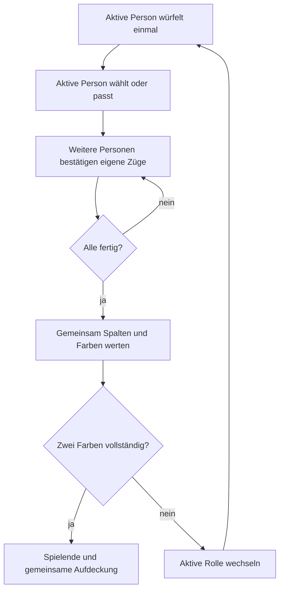
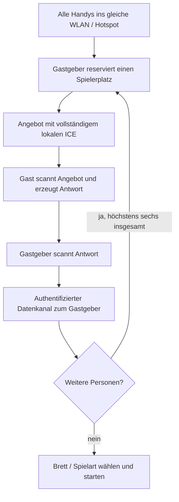
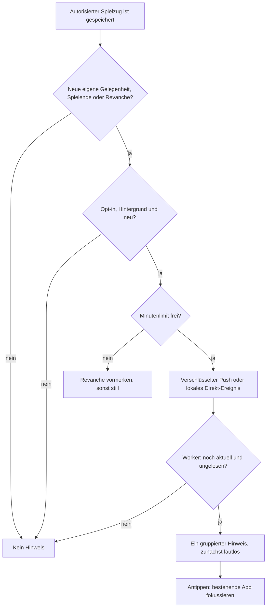
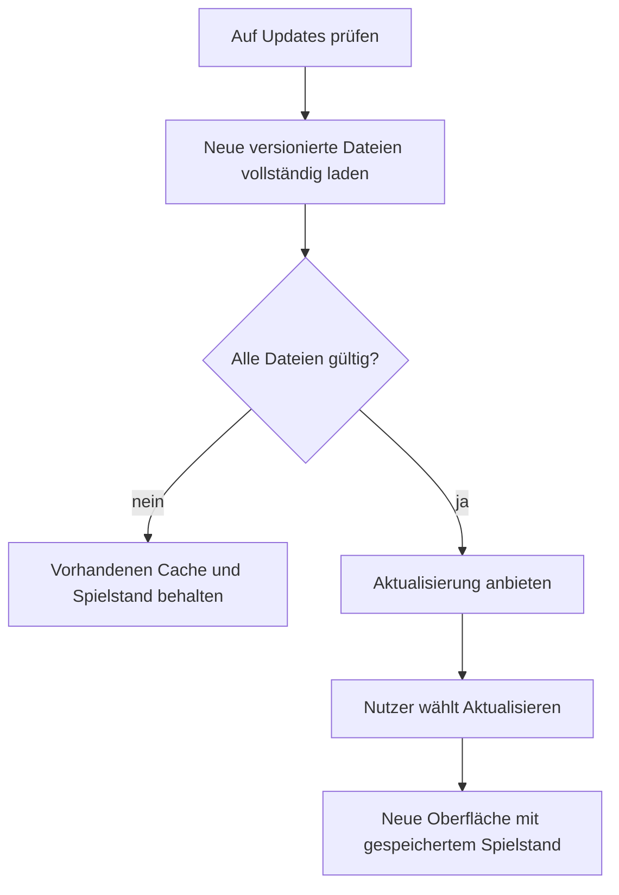

# Abläufe

<!-- farbfeld-version: 1.16.0 -->

## Neu 1.16.0: Offline-Testprotokoll und optionale Computer-Minen

Ein freiwilliges lokales A/B-Testprotokoll hilft bei Offline-Kopplung und Spielabgleich; es ist aus Einstellungen und Kopplungsdialogen exportierbar. [Testanleitung und Datenschema](offline-diagnostics.md). Die neue Startoption **Minenangriff testen** gilt vorerst nur gegen den Computer: gegnerischer Farbabschluss schaltet einen einmaligen Angriff für fünf Punkte frei. Ein leeres Zielfeld ist ein vollständiger Fehlschlag ohne Nachbarschaden. Nach einem Treffer gehen Erstboni sofort an den verbleibenden vollständigen Halter; ohne Halter werden sie erneut frei. Wiedervervollständigen bei bestehendem Halter erhält den Späterbonus. [Regeln, verdeckte Zielwahl und Wertung](mines.md).

## Start einer Internet-Revanche

Spielende → Host wählt „Noch einmal spielen“ → Lobby ohne Push → Host bestätigt Start → neue Spielkennung mit Rematch-Marker → einmaliger Hinweis an die anderen berechtigten, optierten und kompatiblen Geräte. Eigener Zug hat Vorrang; sichtbare Apps bleiben still. Ist das Minutenlimit noch belegt, bleibt der Auftrag vorgemerkt und wird bei einer normalen Aktion oder dem vorhandenen Wartungslauf geprüft. Vor Versand/Anzeige gewinnen Abbruch, erledigte erste Auswahl, Partiewechsel und fehlender Zugang. Der Benachrichtigungsklick öffnet den vorhandenen Raum ohne Spielaktion.

## Zustellverlauf und Wiederherstellung ab 1.14.0

**Push-Status prüfen** lädt zusätzlich die letzten höchstens zwanzig Versände dieses Geräts. Sie zeigen Ereignisart, Zeit, Versuchszahl und Provider-/Browserstatus; nach einem registrierten Antippen außerdem den Klick. Die Daten enthalten keine Namen, Punkte, Abonnements oder Geheimnisse. Eine Browserquittung bestätigt weiterhin kein menschliches Lesen oder eine sichtbare Sperrbildschirmdarstellung.

Neue automatische Hinweise werden vor der Antwort an die spielende Person als eigener Auftrag gespeichert. Bis zu drei kurze Versuche laufen nach dem gespeicherten Spielzug; insgesamt höchstens vier. Erneut versucht werden nur Netzwerk-/Zeitfehler, HTTP 429/5xx oder ausdrücklich quittierte Prüf-/Anzeigefehler vor einer Anzeige. Retry-After wird eingehalten. Eine Providerannahme ohne Browserquittung führt nicht zum erneuten Versand. Vor jedem Versuch gewinnen ein überholter Zug, entfernter Zugang, abgeschaltete Hinweise, ersetztes Abonnement oder Ablauf. Testmeldungen behalten ihren einmaligen Versand und ihre Minute Frist.

Der feste Wartungsaufruf **POST /api/notifications/maintenance** mit leerem JSON-Objekt kann ausschließlich solche gespeicherten Aufträge wiederaufnehmen; keine Ziele oder Inhalte lassen sich angeben. Eine globale Minuten-Lease und höchstens zwölf Aufträge pro Lauf begrenzen ihn. Der eingerichtete stündliche Check ist eine langsame Rückfallebene für abgebrochene oder länger aufgeschobene Versuche, keine Zusage sekundengenauer Zustellung. Auch normale neue Spielaktionen nehmen fällige Arbeit auf. Die PWA erhält keine Hintergrund-Abfrageschleife. GET derselben Route zeigt nur Bereitschaft und Zeitpunkt des letzten Wartungslaufs. Ob die Aufgabe tatsächlich eingerichtet ist, steht im Deployment.

Der Service Worker darf die aktuelle Gelegenheit zweimal mit jeweils fünf Sekunden Frist prüfen, nur innerhalb des einzelnen Push-Ereignisses. Er zeigt bei nicht verifizierbarem Zustand keinen alten Hinweis. Eine Anzeige-Reservierung verhindert konkurrierende Anzeigen; erst erfolgreicher showNotification-Aufruf setzt „verarbeitet“ und das Minutenlimit. Ablehnung gibt die Reservierung frei. Beim Neustart wird eine vorhandene Meldung desselben Ereignisses erkannt. Eine während der Prüfung sichtbare App bleibt still.

Migration 0008 ergänzt notification_dispatches mit Geräte-/Raum-Cascade, Versuchszähler, Leasing und bereinigter Diagnose. Nicht mehr wartende Einträge werden auf zwanzig pro Gerät und sieben Tage begrenzt. Wartende Hinweise bleiben nur innerhalb ihrer 24-Stunden-Frist versendbar. Bestehende Geräte, Schlüssel, Backups und Spielregeln bleiben verwendbar; neue Worker-Funktionen benötigen das normale PWA-Update.

Computer-Spielkopf: Im Handy-Hochformat Titel/Stärke neben Zurück, danach Wurf/Punkte/Beenden als eigene Steuerungszeile. Titel antippen → Stärke wählen → übernehmen erhält den laufenden Zug. Nach Spielende entfallen Abbruch und dessen Rasterspalte.

## Computer-Stärke wählen und ändern

Gegen den Computer → Leicht/Mittel/Schwer wählen → Brett und Punkte wählen → starten. Mittel ist die Vorgabe neuer Partien; Auswahl bleibt gerätelokal gespeichert. In der Partie Titel mit Einstellungssymbol oder Einstellungen → Computer-Stärke → Ändern → Stärke übernehmen. Ein offener Dialog pausiert wie bisher den Computer; nach Schließen verwendet der nächste Computerzug die gespeicherte Stärke. Eigene ausgewählte Würfel/Felder bleiben erhalten. Fortsetzen, Neuladen und JSON-Backup erhalten die Stufe. Alte Spiele ohne Feld bleiben Leicht. Alle Stärken nutzen dieselben Regeln, das gewählte Brett und gemeinsam einmal gewürfelte Werte. [Strategie](computer.md).

## JSON-Sicherung exportieren

Einstellungen → Lokale Spielstände exportieren → Download als `YYYYMMDD_Farbfeld_Spielstand.json`. Beispiel: `20261108_Farbfeld_Spielstand.json`. Der Datumsteil ist der lokale Exporttag des Geräts. Spiel, Einstellungen, Verlauf und Statistik bleiben im vorhandenen Backupformat. Spielstände importieren akzeptiert weiterhin zuvor exportierte JSON-Sicherungen unabhängig vom Dateinamen.

## Gespeicherte Partien auf der Startseite

Oben gespeicherte Internet-Räume → direkt darunter laufende Solo-/Computer-/Ein-Handy-Partie → gespeicherte Offline-Direktverbindung → erst danach Startüberschrift und Illustration. „Weiterspielen“ öffnet den vorhandenen lokalen Stand; „Öffnen“ bei Direktpartien setzt Spiel/Kopplung fort. Bereits angebotene Abbruchaktionen bleiben erhalten. Ohne Internet-Räume stehen lokale und direkte Fortsetzen-Karten unmittelbar unter dem App-Kopf; ohne gespeicherte Partien folgt direkt der Hero. Jede Karte nur einmal, unabhängig von der Bildschirmbreite.

## Design und zusätzliche Reaktionen ab 1.12.0

Einstellungen → eines von sechs Designs wählen → Gerätepräferenz speichern → zweifarbige Startüberschrift und Dekoration bzw. Spielmarkierungen aktualisieren. Dunkle Grundfarbe und hervorgehobener Design-Akzent bleiben getrennt; die Startseite hält den Abstand zum oberen Inhalt kompakt. Kein Banner über der Startseite; Standard behält „Ein Wurf. Viele Möglichkeiten.“. Das Hunde-Design zeigt dieselbe einzelne braune Pfote in Kachel, Hero und Spielmarkierung, unabhängig vom Emoji-Stil des Geräts. Auswahl verändert weder Mitspielende noch Regeln oder Punktestand.

Versionsnummer zehnmal → ☺ neben Einpassen → 😘/💩/😂/👍/😲 → optional halten → einmal beim Loslassen senden. Für die beiden neuen Symbole bestätigt der Raum die Empfängerfähigkeit bzw. der Direkt-Gastgeber seine eigene und die der Empfänger. Fehlende Fähigkeit ergibt eine Updatehilfe auf 1.12.0; kein stiller Verlust. Bestehende Raumabrufe erneuern die Fähigkeit der jeweils authentifizierten Person.

Push-Status prüfen → jüngster gespeicherter Versuch mit Art und Zeitpunkt → Providerannahme von der Rückmeldung des Browsers unterscheiden. `shown` heißt „Browser hat die Anzeige angefordert“, ohne Zusage einer sichtbaren Android-Meldung. Ein Start im Hintergrund entfernt keine ungelesene Meldung; die tatsächliche sichtbare Rückkehr darf aufräumen, bewusstes Ausschalten schließt weiterhin sofort. Kein zusätzlicher automatischer Abruf. Tonwahl erlaubt bei einem tatsächlich neuen berechtigten Hinweis auch die Ankündigung beim Ersetzen des alten Eintrags; lautloser Standard, Minutenlimit, Vordergrundsperre und Deduplizierung gelten weiter.

## Design wechseln

In **Einstellungen → Dein Design** Standard, Halloween, Weihnachten, Quietschenten, Hunde oder Geburtstag wählen. Die Auswahl bleibt lokal gespeichert und passt Dekoration und Spielfeldmarkierungen an. Das Farbfeld-Logo oben links und in der Ladeansicht bleibt dabei unverändert, auch nach einem Neustart oder offline.

## Eine gemeinsame Runde

In den ersten drei Würfen bleiben alle Würfel verfügbar. Danach stehen den anderen Personen die zwei gewählten Würfel der aktiven Person nicht zur Verfügung, außer sie passt. Gleichzeitig erste Abschlüsse im selben Wurf erhalten denselben Erstbonus. Solo endet nach 30 Würfen. Brett und verdeckte Spielart stehen vor dem Start fest.

## Profil nach Spielende

Ein bestätigter Endstand erzeugt pro Spiel-ID höchstens einen lokalen Ergebniseintrag mit eigener Spielerrolle. Der kompakte Statistikverlauf erhält ihn auch dann, wenn die sichtbare 100er-Ergebnisliste später weiterläuft. Der Statistik-Button öffnet standardmäßig **Mit anderen**; **Computer** und **Solo** sind eigene Bereiche mit getrennten Bestwerten, Durchschnitten und Serien. Die Ergebnisliste folgt dieser Auswahl. Namen in der Gegnerbilanz öffnen direkte Siege/Remis/Niederlagen, Siegquote, eigene Punktwerte, Serien und fünf letzte Duelle. Rücksprung erhält den gewählten Bereich. Geteilte Gesamtsiege zählen zur Bereichsserie, ein direktes Remis unterbricht die Gegner-Siegesserie. Abbruch zählt nicht. Backups sichern die Statistik mit; Import führt IDs zusammen. Alte Ergebnisse ohne eindeutige Rolle bleiben gekennzeichnet. Details: [statistics.md](statistics.md).

## Internet-Spielraum und weitere Partien

1. Gastgeber erstellt den Raum mit persönlichem Namen und optionalem Raumnamen. Andere treten über den unveränderten Code bei; maximal sechs Personen.
2. In der Lobby sehen alle denselben Raumnamen. Der Gastgeber darf umbenennen, Gäste entfernen und Brett/offene oder verdeckte Punkte wählen. Gesperrte Varianten nennen die noch nicht bestätigte Person. Diese öffnet den gespeicherten Raum auf ihrem eigenen Handy im Vordergrund; der normale Abruf registriert die aktuellen Brettfähigkeiten neu. Auch ein vor Einführung der Bretter erstellter Raum wird so freigegeben. Ab 1.6.0 reicht die passende Unterstützung, sonst aktualisieren. „Raum neu prüfen“ liest die eigene Ansicht erneut.
3. Während einer Partie bleibt die Besetzung fest. Umbenennen bleibt möglich und verändert keine Würfel, Markierungen oder unbestätigte Auswahl.
4. Nach Spielende wählt der Gastgeber **Noch einmal spielen**. Alle landen im selben Raum wieder in der Lobby. Dort Brett und Besetzung für die nächste Partie ändern, dann **Partie starten**.
5. Ein entfernter Gast erhält einen verständlichen Zugangshinweis. Ein erneuter Beitritt mit Code erzeugt einen neuen persönlichen Zugang; es gibt keine automatische Endlosschleife für das ungültige Token.

Details: [Internet-Spielräume](internet-rooms.md).

## Status und Rückkehr zum Spiel

Die Startkarte zeigt zuerst den Raumnamen, unmittelbar darunter die gemeinsame Zeile **Raumcode · Spielerzahl** und danach den aktuellen Zugstatus. Eine noch nicht geladene Spielerzahl bleibt bis zum vorhandenen Raumabruf weg. Eine eigene Gelegenheit erhält „Du bist dran“ mit einem kleinen Aktionszusatz. Zum Öffnen/Weiterspielen dient ein kompakter Pfeil rechts neben dem Text, auch auf dem Handy. Er bleibt mindestens 44 × 44 CSS-Pixel groß und für Bildschirmleser beschriftet; eine zusätzliche Button-Zeile entfällt. Ein Statuswechsel behält diese Anordnung bei.

In der Partie wird der volle Raumname über den Bedienelementen umgebrochen. Code und Spielerzahl stehen direkt darunter in derselben Überschriftengruppe, auch im Querformat. Im schmalen Hochformat folgt eine über die ganze Breite gefüllte Zeile **Wurf · Punkte · Beenden**. Nach Spielende fällt Beenden weg und die beiden verbleibenden Bereiche teilen die Breite. Punkte öffnet weiter die Übersicht, Beenden erfordert weiterhin Bestätigung. Nach Bestätigung des eigenen Netzwerkzugs verschwindet das gesperrte Würfelpanel und eine kurze Statuszeile nennt die noch handelnden Personen. Mit der nächsten eigenen Gelegenheit erscheinen die aktiven Würfel wieder. Beim bloßen Betrachten eines fremden Blatts oder einer unterbrochenen Direktbestätigung bleiben die passenden Rückkehr-/Wiederverbindungsaktionen erhalten.

Die Startseite liest einmal einen kompakten autorisierten Sammelstatus für höchstens 50 gespeicherte Räume. Bei bekannten laufenden Partien folgen höchstens minütliche Sammelabrufe; jede Karte hebt die eigene erlaubte Aktion hervor. Das ausdrückliche Öffnen eines Raums liefert dessen vollständige persönliche Ansicht und erneuert seine Nutzungsfrist. Im Raum wird das Intervall je nach eigener Spielgelegenheit, Wartezeit und Fehlern angepasst. Im Hintergrund und ohne Netz stoppt der Timer. Beim Rückkehren wird einmal neu abgeglichen. Statuspunkte kommen mit diesem Abruf und führen keinen Zug aus.

Nach mindestens 24 Stunden ohne Start/Wurf/Zug/Passen kann ausschließlich der Ersteller einen noch fehlenden Zug als Passen werten. Die API prüft Rolle, Frist, Version und Engine-Berechtigung. Danach startet die Frist erneut. Status-/Präsenzabrufe und Umbenennen lösen weder einen Skip noch eine neue Frist aus. [Details](room-status.md).

## Lokale Direktkopplung

Mit Internet darf ein kurzlebiger Code Angebot und Antwort vermitteln. Während der Partie wird nicht erneut gescannt. Ein Verbindungsabbruch pausiert alle; gespeicherte bestätigte Züge bleiben erhalten. Nach komplettem Neustart werden die bisherigen Plätze mit dem ursprünglichen Gastgeber neu gekoppelt. Details: [offline-multiplayer.md](offline-multiplayer.md).

## Zurückhaltende Benachrichtigungen

**Geräteanzeige testen** prüft die lokale Ausgabe. **Internet-Push testen** erzeugt eine authentifizierte Testnachricht nur an die eigene Installation und zeigt Provider-/Gerätefeedback; dieser ausdrücklich ausgelöste Test darf auch im Vordergrund erscheinen. **Push-Status prüfen** bindet mit dem gespeicherten persönlichen Zugang erneut und bestätigt den Serverstand einmalig, ohne Nachricht oder neuen Timer. Für einen echten Spielhinweis mindestens eine Minute nach dem lokalen Test warten, die App vor einer neuen eigenen Gelegenheit verbergen und dann vom Gegenüber weiterspielen lassen. Bereits sichtbare oder beim Aktivieren vorhandene Gelegenheiten werden nicht nachgeholt. Bestätigte Bindungen folgen Raumwechseln während laufender Requests seriell; alte Verbindungsfehler verschwinden nach erfolgreichem Abgleich.

Auch wenn die empfangende App seit einer Stunde geschlossen ist, erzeugt ein neuer freigegebener eigener Zug serverseitig einen Push. Bei vorübergehend fehlender Geräteverbindung darf dieser seit 1.9.8 bis zu 24 Stunden auf Zustellung warten; erst eine erneute Raumprüfung und lokale Deduplizierung erlauben seine Anzeige. Ein inzwischen erledigter oder gelesener Zug bleibt still. Es gibt keine periodischen Erinnerungen und keine Meldungen für Joins, Emojis, Spalten oder Farben. Innerhalb des Minutenlimits verpasste Zugereignisse werden nicht gesammelt nachgeliefert. Nur ein neuer Revanche-Start bleibt als einzelner Auftrag bis nach der Minute vorgemerkt. Das Öffnen fokussiert ein bestehendes Fenster und erhält eine unbestätigte Auswahl. Bei geschlossener App öffnet der Hinweis `/play` mit Raumcode oder Direkt-Einstieg, ohne Zugangsschlüssel in der URL.

## Atomare PWA-Aktualisierung

Updatechecks erfolgen beim Start, bei Internet-Rückkehr und Sichtbarwerden sowie alle fünf Minuten im Vordergrund; schnelle Wiederholungen sind gedrosselt. Ein fertig geladenes Update zeigt einen auch im Querformat erreichbaren Banner mit **Jetzt aktualisieren** und **Später**. „Später“ verbirgt dieselbe Version für diese Sitzung; unter Einstellungen ist sie weiterhin verfügbar.

Kein ungefragtes Neuladen einer offenen Auswahl. APIs und Geheimnisse werden nicht Teil des Offline-Dateicaches. Direktkanäle müssen nach einem vollständigen Neustart nötigenfalls erneut gekoppelt werden.

Im niedrigen Querformat folgt auf die vollständigen Würfelzeilen ein kurzer Zughinweis mit **i**, danach Passen/Bestätigen. Die Infoaktion öffnet die gesamte Erklärung. Bei knapper Höhe scrollt die rechte Box als Ganzes, ohne dass der Hinweis die Würfel verdrängt oder überdeckt. Neue Auswahl, Joker, Fehler und gültige Züge verwenden dieselbe Anordnung; im Hochformat bleibt der ausführliche Hinweis.

## Verpasste Emoji-Reaktion

1. Freigeschaltete Person sendet 😘, 💩 oder 😂 gezielt oder an alle. Der Raum speichert die Reaktion unabhängig vom Spielzug.
2. Der normale Raumabruf liefert je Absender die neueste für die betrachtende Person bestimmte Reaktion innerhalb derselben Partie, höchstens 24 Stunden alt. Das funktioniert beim ersten Abruf nach Öffnen, ohne neue Hintergrundabfragen.
3. Bei sichtbarer App fliegt sie kurz über den Bildschirm; nach spätestens drei gleichzeitigen Flügen warten weitere Absender auf einen freien Platz. Die Person benötigt keinen eigenen Senden-Knopf.
4. Der lokale Anzeigecursor verhindert Wiederholung nach Abruf oder Neustart. Im Hintergrund wird nichts ungesehen abgehakt. Bei einer neuen Partie bzw. nach Fristablauf entfällt die alte Reaktion.

Keine Emoji-Pushs. Der lokale Direktmodus verwendet weiterhin nur die bestehende Live-Verbindung und erhält dadurch keine Server-Warteschlange. [Details](reactions.md).

## Emoji halten und loslassen

Im Emoji-Menü tippen für Normalgröße oder gedrückt halten: Die Vorschau wächst bis 2,5-fach nach 2,5 Sekunden. Loslassen innerhalb des Knopfs sendet seit 1.10.1 direkt genau eine Reaktion, unabhängig von einem späteren Browser-Klick. Nachfolgende Kompatibilitätsklicks werden abgefangen. Während der Anfrage zeigt die App „Reaktion wird gesendet …“; bei Fehler bleibt die Auswahl wieder bedienbar. Herausziehen, Pointerabbruch, Verbergen oder Schließen bricht ab. Leertaste und Enter können ebenfalls gehalten werden. Die gewählte Größe und eine wechselnde Flugbahn gehen gemeinsam an die Empfänger und bleiben auch für spätere Raumabrufe erhalten. Keine zusätzliche Push-Meldung und keine Spielzugaktion.

## Mehrere Partien parallel

Startseite „Deine Räume“ → Raum hinzufügen/beitreten → eigener Zugang bleibt zusätzlich erhalten → bestehenden Raum öffnen → dessen Partie fortsetzen. Zurück zur Startseite oder „Alle Räume“ → anderen Raum öffnen. Pro Raum eine Partie, beliebig zwischen den gespeicherten Räumen wechseln; reguläre Speichergrenze 50. Ein passender lokaler Entwurf kommt bei unveränderter eigener Spielgelegenheit zurück. Nach Spielende als Gastgeber „Noch einmal spielen“ → gleiche Lobby und gleicher Code, neuer Spielstand.

Nach 14 Tagen ohne Öffnen/Rückkehr oder akzeptierte Aktion kann ein Raum bei der nächsten normalen Bereinigung gelöscht werden. Solange er noch gespeichert ist: öffnen → alte Partie/Ergebnis bleibt erhalten → Frist erneut vierzehn Tage. Nach tatsächlicher Löschung: verständliche Meldung, lokale Zugänge anderer Räume und Ergebnisse bleiben erhalten. „Zugang entfernen“ entfernt nur genau den gewählten Geräteeintrag. Kein Account und keine Wiederherstellung eines verlorenen Spielerschlüssels nur anhand des Namens.

Push-Klick in einem anderen gespeicherten Raum → passenden Zugang auswählen → Raum öffnen. Fehlender gespeicherter Zugang → Code im Beitrittsdialog, kein automatischer Identitätswechsel. Alle gespeicherten berechtigten Räume teilen dasselbe Minutenlimit und denselben Benachrichtigungseintrag.

## Spielhinweise ab 1.11.1

Eine neue eigene Gelegenheit oder das Spielende wird nach dem Spiel-Commit an berechtigte, nicht sichtbare Geräte verteilt. Der korrigierte Worker-Transport erreicht den Push-Dienst ohne automatische Weiterleitung; Weiterleitungen und andere Fehler bleiben begrenzte fehlgeschlagene Versuche. Kein zusätzlicher Timer, keine wiederholten Erinnerungen und keine Meldungen für Emojis, Lobby-Beitritt oder Farbfertigstellung. Der lokale Menütest bestätigt nur die Geräteanzeige. Zum Endgerätetest eine neue Gelegenheit nach dem Verbergen der App und außerhalb des Minutenlimits erzeugen.

## Internet-Push gezielt prüfen (1.11.2)

Einstellungen → Benachrichtigungen → Internet-Push testen. Aktualisierten Worker und aktivierte Registrierung prüfen, dann authentifizierten Selbsttest senden. Der Server beansprucht eine globale Minutensperre und protokolliert den Transport. Das Gerät prüft die aktuelle Testfreigabe, fordert genau eine Anzeige an und quittiert das Ergebnis; ein offenes Fenster aktualisiert sich ohne weitere HTTP-Abfrage. Falls die Quittung später eintrifft, ist sie über Push-Status prüfen lesbar. Der lokale Geräteanzeige-Test bleibt eigenständig. Kein Gegnerzug oder Raumwechsel für den Test nötig, kein späterer Erinnerungsstau.

