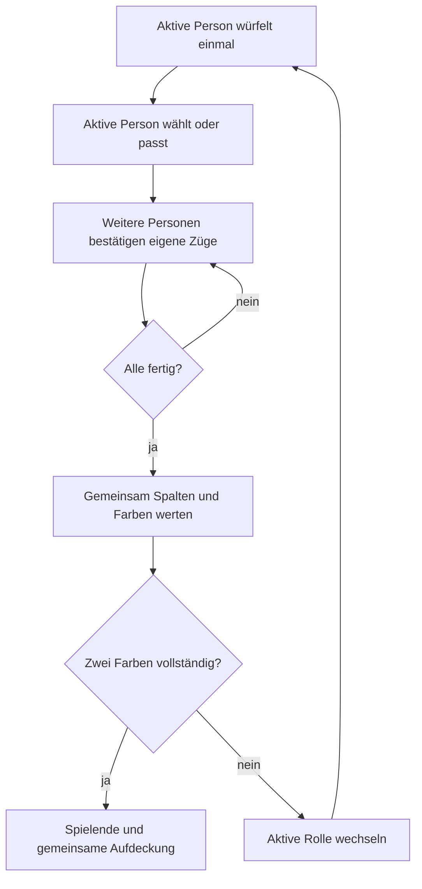
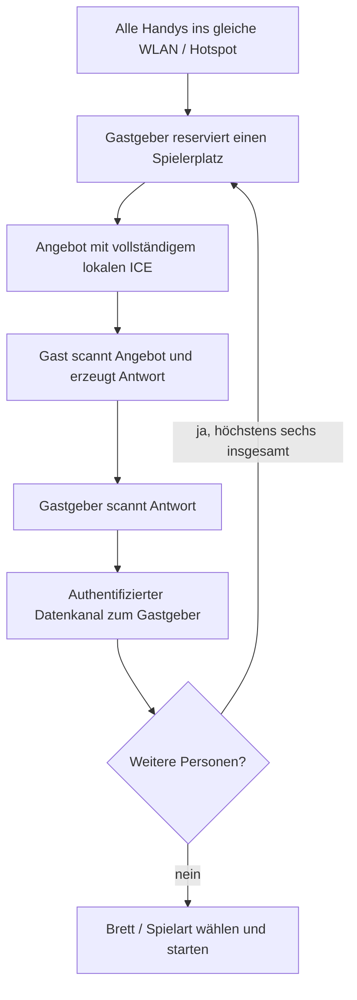
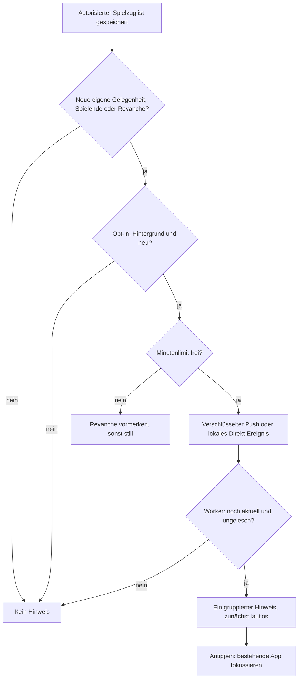
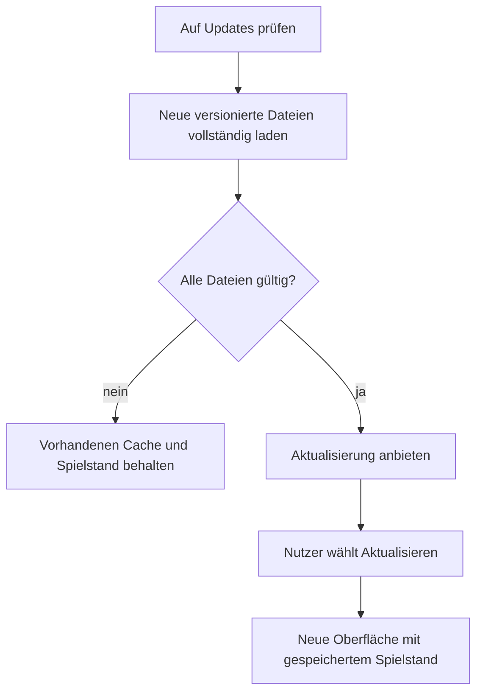

# Abläufe

<!-- farbfeld-version: 1.34.2 -->

## Website, Spiel und Impressum öffnen

Die öffentliche Startseite erklärt Spielablauf und Varianten. **Jetzt spielen** öffnet `/play`; die Links zu den Varianten öffnen das zugehörige Kapitel der Spielanleitung. **Website** und **Impressum** stehen am Ende der App-Startseite. Im Impressum zeigt **Kontaktdaten anzeigen** die beiden Kontaktlinks.

## Spielanleitung ansehen

Das **Fragezeichen** oder `/play?anleitung` öffnet die Spielanleitung. Wähle ein Thema und gehe mit **Weiter** durch die Beispiele. Die nummerierten Schritte öffnen dieselben Clips direkt. Unter dem Clip erklären **So zählen die Punkte** und **Regeln im Überblick** Wertung und Voraussetzungen. **Grundregeln im Detail** öffnet die ausführlichen Spielregeln.

## Luftangriff freischalten

In einer neuen Partie mit der Zusatzregel gibt ein gewerteter gegnerischer Farbabschluss einen Angriff frei. Ein bestätigter Stand mit 70 Kreuzen auf einem einzelnen Gegnerbrett gibt unabhängig davon einen weiteren frei. Bei beiden bereiten Angriffen nutzt **Ziel wählen** zuerst die Farbfreischaltung. Ziel bestätigen → 5 Punkte Einsatz → der normale Zug steht weiterhin bereit. Die Regeln und Ablaufdiagramme für alte Stände gelten weiter. [Luftangriff](mines.md)

Das **?** in der Luftangriff-Karte zeigt Freischaltungen, Kosten und Brettmarkierungen für die aktuelle Partie. Die Statuschips stehen direkt unter dem Titel.

## Zum Spielfeld springen

**Zum Spielfeld** sitzt unten rechts, sobald das Brett verfügbar ist. Antippen oder mit der Eingabetaste auslösen springt zum angezeigten Spielfeld. In der festen Würfelleiste sitzt das Gitter-Symbol in einer eigenen Position unten rechts neben den Spielaktionen.

## Schaden und wichtige Spielereignisse

Nach einem Luftangriff steht der Bericht in **Luftangriff**. Nach einer Minenexplosion erscheint der Schaden des sichtbaren Spielfelds im geöffneten Bereich **Versteckte Minen**. Dort steht, wie viele Kreuze entfernt oder wieder angekreuzt wurden und wie lange die Markierungen sichtbar bleiben. Das Raster markiert die betroffenen Felder.

Bei einem neuen sichtbaren Einschlag holt Farbfeld die Zielfelder bei Bedarf vor dem Effekt in den Ausschnitt. Der Sprung berücksichtigt seitliches Scrollen, das Banner oben und die feste Würfelleiste. Bei einer versteckten Mine bleibt das ausgewählte Brett aktiv.

Luftangriffe, Minenexplosionen, versenkte Schiffe und neu gewertete Farbabschlüsse erscheinen im Banner oben. Beim eigenen Schatzfund zeigt das animierte Geschenk den Fund an. Beim Wurfende zeigt das Banner die gewerteten Schätze und einen vollendeten eigenen Schatzkettenbonus. Die animierte Fahne erscheint beim gewerteten eigenen öffentlichen Auftrag. Einzelne Schiffstreffer erhalten ihren Impuls auf dem Raster. Die PC-Diagnose erfasst die Banner und den 2,2 Sekunden langen Anflug in der aufgenommenen Spielansicht.

## Animationstaktung testen

In der PC-Diagnose eine Szene öffnen und **Abspielen** wählen. In der Zeitleiste den gewünschten Schritt aufklappen und den Abstand zum vorherigen Schritt eingeben. **Startansicht** enthält die Zeit bis zum ersten Schritt. **Zeit nach dem letzten Schritt** bestimmt, wie lange die Aufnahme anschließend weiterläuft. Jedes Zeitfeld nimmt Millisekunden an und lässt sich mit **−100** und **+100** verstellen. **Mit Zeiten abspielen** wiederholt die Aufnahme links. **Bis hier abspielen** verwendet die gewählten Zeiten bis zum Eintrag. **Zeiten zurücksetzen** stellt die gemessenen Werte wieder her. **Neu aufzeichnen** erstellt eine neue Aufnahme.

## Aufträge und letztes Ergebnis

Lies pro öffentlichem Auftrag deinen bestätigten Fortschritt und die Restfrist direkt in der Übersicht. Für den Endstand der vorherigen Partie tippe auf den Pokal beim Raumnamen. Während der Aufstellung findest du ihn neben **Zur Startseite**.

## App aktualisieren

Der Hinweis auf der Startseite zeigt ein bis zwei Stichpunkte zur neuen Version. **Details** führt direkt zu den Versionshinweisen in den Einstellungen. Mit **Jetzt aktualisieren** startest du die neue Version. Nach **Später** findest du sie weiterhin in den Einstellungen. Dort sind auch die ausführlicheren Hinweise zur installierten Version abrufbar.

## Animationen testen

Am PC die [PC-Diagnose](https://farbfeld-andrew.endruuu.chatgpt.site/diagnose) oder **Einstellungen → Hilfe & Diagnose → Animationen testen** öffnen, ein Beispiel auswählen und **Spielansicht öffnen** anklicken. In der vollständigen Beispielpartie kannst du vor **Abspielen** auf die Stelle scrollen, die du sehen möchtest. Während der Szene ziehen Ereignisse und Scrollwechsel wie im Spiel nach. **Zur Auswahl** öffnet wieder dieselbe Szene im Menü. Für die Effekte auf dem Beispielbrett gibt es **Ausschnitt abspielen**.

Am PC erscheint die Zeitleiste nach dem Durchlauf rechts unter **Ablauf prüfen**. Ein Klick auf einen Eintrag zeigt links den erfassten Ausschnitt und markiert das sichtbare Element. **Zur Spielansicht** kehrt zur laufenden Vorschau zurück. **Bis hier abspielen** wiederholt die Szene von derselben Ausgangsansicht bis zu diesem Bild. **Feedback kopieren** übernimmt die Angaben zur gewählten Stelle in die Zwischenablage.

## Rückspiel und eigene Vorbereitung · 1.25.0

Eigener Zug bestätigt → Startseite → unter **Deine Räume** steht die Zahl der Partien, in denen du weiterhin dran bist. Die Glocke öffnet **Ergebnisse** mit den jüngsten 20 gespeicherten Abschlüssen. Jeder Eintrag zeigt Datum, Uhrzeit und den eigenen Ausgang und öffnet seinen Endstand. Wer einen Internet-Raum oder eine Direktpartie erst nach dem Revanche-Start wieder öffnet, sieht das vorige ungesehene Ergebnis automatisch. Durch **Letztes Ergebnis ansehen** kann jede früher beteiligte Person im Raum den Endstand erneut anzeigen.

Schiffsboni und versteckte Minen wählen → eigene Flotte bestätigen → eigene Minen auslegen und bestätigen → warten, falls noch andere vorbereiten. Beim gemeinsamen Handy wird nach beiden Schritten weitergegeben. In Online- und Direktpartien können sich alle gleichzeitig auf ihren Geräten vorbereiten. Links in der Schusskarte steht Zeile 1–7. Nach einem bestätigten Suchzug zeigt **Schatzsuche** die eigene Nähe, Spur und Historie.

## Abwechslungsreiche Partien und vergleichbare Endergebnisse · 1.24.0

Öffentliche Aufträge aktivieren → neue Partie starten → drei verschiedene gemeinsame Ziele aus 40, je eine Frist 12/20/Spielende. Hilfe → Alle 40 Aufträge ansehen zeigt den Vorrat. Fortsetzen/Import lädt die konkrete bestehende Auswahl ohne Neuverlosung.

Letztes Schiff versenkt / letzter Schatz vergeben / alle eigenen Aufträge erfüllt oder abgelaufen / alle versteckten Minen verbraucht → betreffende Detailkarte einmal schließen. Manuelles Wiederöffnen bleibt über folgende Ansichtsaktualisierungen erhalten. Nicht aufklappbare Statuskarten sind schon kompakt.

Spielende → Ergebnis → Punkte vergleichen → Person antippen → Kategorien mit deinen Werten, ihren Werten und Differenz vergleichen. Deine Zuordnung bleibt beim Browsen bestehen. Verdeckte Partien werden erst am Ende aufgedeckt; Ausgestiegene haben fest −10. Die normale vollständige Punkteübersicht bleibt über Alle Punkte vergleichen verfügbar.

Auf dem Hauptbrett sind A–O stärker lesbar und 1–7 links beschriftet. Einpassen berücksichtigt den Nummernrand, sodass die Brettbreite nicht wächst; Scrollränder halten die Zoom-/Fit-Aktionen über der festen Würfelleiste erreichbar.

## Fünf Suchzüge und vergebene Schätze · 1.23.2

Eigenen gültigen Suchzug bestätigen → Messung im eigenen Verlauf anhängen → nur die jüngsten fünf behalten → Schatzsuche aufklappen: neueste Messung zuerst, mit Wurf/Feldern/Temperatur. Nach der gemeinsamen Fundwertung wird der tatsächliche Schatzslot als eigener Fund oder durchgestrichen/vergeben dargestellt. Nach allen Funden bleibt der Verlauf sichtbar. Speichern/Neuladen erhält ihn; alte Spielstände wachsen aus ihrem bisher gespeicherten letzten Hinweis heraus. Passen fügt keinen Suchzug hinzu.

## Eigene Ansicht, Mine und Suchfelder · 1.23.1

Gegner trifft deine versteckte Mine → du bleibst auf dem betrachteten Blatt → unter Versteckte Minen steht kompakt der letzte Betroffene/Schaden → aufklappen für alle Berichte, im offenen Spiel einschließlich Auslösefeld/entfernten Feldern. Eingehende eigene Schäden werden ebenfalls hier dokumentiert. Verdecktes Spiel nennt nur Anzahl/Person und „Position verdeckt“. Berichte bleiben nach Neuladen und nach Ablauf der kurzfristigen Brettmarkierungen bestehen. Ein manuell gestarteter Luftangriff behält seine bisherige Ansichtsauswahl.

Laufende ältere Computer-Schatzsuche fortsetzen → „Hinweis nach Zug“ → gültigen normalen/Extra-Zug bestätigen → z.B. „Heiß: H1“ → aufklappen für Suchzug und sichtbare Schrittlegende. Hinweise starten auch, wenn der Computer zuerst den nächsten Zug bestätigt; eigene Messung folgt erst dem eigenen Zug. Die alte Maximalwertung sechs bleibt erhalten. Ein schon vorhandener 1.23.0-Suchzug zeigt seine eigenen Suchkoordinaten als Rückfall, bis ein neuer Zug präzisere focus-Koordinaten liefert. Speichern/Neuladen bewahrt Messung und Funde.

Im Handyquerformat stehen kurze Karten paarweise; geöffnete Berichte/Details nutzen ganze Zeilen ohne große ungenutzte Nachbarhälften. Hochformat bleibt kompakt untereinander. Punkte rechts, Fortschritt/Fristen darunter und Hilfe/Details getrennt.

## Schatzsuche 1.23.0

Neue Computerpartie → Schatzsuche auswählen → normalen Zug bestätigen → Temperatur der neu gesetzten Kreuze erhalten → nach der gemeinsamen Wurfwertung eigenen Fund und nächste grobe Spur anzeigen → alle drei eigenen Funde ergeben einmalig +3 zusätzlich. Ungültige Auswahlen, Entwürfe, bloßes Öffnen und Passen erzeugen keine Messung. Die Wurfnummer ordnet historische Hinweise ihrem Suchzug zu.

Aufklappen zeigt Kette, eigene Suchkoordinaten, Spaltenband und Verlauf; Regelhilfe klappt die Karte nicht mit um. Normale Neudarstellung behält die geöffnete Karte im selben Match/eigenen Teilnehmerkontext. Speichern/Import/Neuladen bewahren Hinweise und Prämien. Menschliche Partien behalten die bisherige Bonusregel. Die 1.23.1-Ergänzung liefert älteren laufenden Computerpartien Hinweise ohne neuen Kettenbonus.

## Schatzsuche und gleichbleibende Hilfeposition · 1.22.5

In der Spieleinrichtung und Lobby **Schatzsuche** wählen. Die Karte zeigt weiterhin eigene Punkte rechts und den entdeckten Anteil darunter; nach dem ersten Fund bleibt der Verlauf aufklappbar. Hilfe und Punkte bewegen sich beim Erscheinen dieses Pfeils nicht. Regelhilfe öffnet weiterhin den eigenen Dialog, getrennt vom nativen Aufklappen. Fundmeldung: „Schatz gefunden“. Bestehende drei geheime Positionen und +2 Punkte pro erstem Trefferwurf gelten unverändert.

## Vollständiges Schiffssymbol · 1.22.4

Flotte bestätigen, Schiffsboni öffnen, Varianten wählen und Punkteergebnis verwenden denselben korrigierten Anker. Keine geänderten Aktionen oder Bestätigungen; Pinch/Einpassen und eigene Schrittfolge aus 1.22.3 bleiben erhalten.

## Eigene Aufstellung vollständig abschließen · 1.22.3

Eigene Flotte auslegen und bestätigen → falls gewählt eigene Minen auslegen und bestätigen → erst dann gegebenenfalls Wartestatus auf andere. Eine noch nicht bestätigte fremde Flotte blockiert die Wahl des nächsten eigenen Vorbereitungsschritts nicht mehr. Würfeln bleibt an alle erforderlichen Bestätigungen gebunden. Versteckte Minen bleiben in der vorhandenen Computerfreigabe; menschliche Flottenaufstellung behält ihre private Übergabe und serverseitige Bestätigung.

In beiden Aufstellungen startet das Raster vollständig sichtbar. Mit zwei Fingern oder −/+ vergrößern, innerhalb des Rasters verschieben, Einpassen zurück auf alle Felder. Vergrößerung/Ausschnitt bleiben bei Schiff-/Minenwechseln erhalten. Der nächste eigene Schritt startet mit seinem eigenen eingepassten Raster. Koordinaten und Drehen funktionieren weiter. Ein Pinch setzt kein Schiff und keine Mine. Seitliche Randfelder und die siebte Zeile bleiben erreichbar.

## Schusskarte und Regeln · 1.22.2

Schiffsboni aufklappen → alle A–O-Spalten und sieben Reihen passen zunächst hinein → bei Bedarf mit zwei Fingern oder −/+ vergrößern → innerhalb der Karte verschieben → Einpassen. Der normale Brettzoom und der aktuelle Zug bleiben erhalten. Das **?** jeder aktiven Regel öffnet ihre Erklärung, ohne die Karte auf-/zuzuklappen. Bestätigte Versenkungen zeigen wieder ein vollständig sinkendes Schiff; verdeckte gegnerische Schüsse bleiben bis Spielende verborgen.

Bei verdeckten Schiffsboni werden gegnerische Schüsse bis zum Matchende weder auf das eigene Blatt gezeichnet noch per Scrollen/Animation verraten. Die eigene Zielkarte bleibt nutzbar. Offene Partien zeigen zellgebundene Treffer-/Wasser-/Versenkungsimpulse; das Ergebnis deckt wieder alle bestätigten Fakten auf.

## Flotte und Minen gleich bedienen · 1.22.1

Beide Vorbereitungen folgen demselben Ablauf: Auswahlkarte wählen → Feld antippen oder Spalte/Zeile wählen → bei Bedarf zufällig verteilen → bestätigen. Flotten bieten zusätzlich Drehen; die normalen Überlappungsregeln gelten weiter. Sind beide Varianten gewählt, folgt nach Flotte bestätigen die Minenvorbereitung; erst danach wird gewürfelt. Lokale private Übergabe und wartende/beschäftigte Netzwerkzustände bleiben erhalten.

## Neue Vorbereitung und bestätigte Explosion · 1.22.0

**Gegen Computer → Varianten → Versteckte Minen → starten**. Falls Schiffsboni gewählt wurden, zuerst die eigene Flotte bestätigen. Danach Mine 1/2 auswählen, auf ein Rasterfeld tippen oder Spalte/Zeile wählen und hier platzieren; Zufällig verteilen bleibt optional. Zwei verschiedene eigene Felder, keine Abstandsregel. Bereits gültige Vorschläge sind editierbar. Erst Minen bestätigen · losspielen schaltet den ersten Wurf frei. Laden oder Zur Startseite verliert keine bereits gespeicherten Positionen.

Ein bestätigter Normalzug einschließlich Zusatzfeld betritt ein gegnerisches Minenfeld: Mine wird einmalig verbraucht, reguläre verdiente Varianten-/Bonusfakten sind bereits erfasst, tatsächlicher Schaden und normale Punkte werden atomar korrigiert. Lichtblitz, Splitter und Wellen liegen an den bestätigten Zellen. Zwei Minen im selben Zug zeigen beide Einschläge und die eindeutige Gesamtzahl entfernter Kreuze. Die normale Abgabe/Rundenwertung läuft weiter; kein zusätzlicher Einsatz oder Zug. Eigene Minen zeigen ein kleines ungefährliches Symbol, die gegnerischen bleiben unentdeckt geheim.

Der bisherige manuelle Ablauf heißt nun Luftangriff: Ziel wählen → H4 angreifen · −5 P. Überflug und Einschlag, erhaltene eigene Auswahl, dieselben Kosten/Freischaltung. Die neue Minenoption erscheint nicht bei Ein-Handy-, Direkt- oder Internetspielen; die vier früher freigegebenen Varianten bleiben dort bestehen.

## Mine wählen und bestätigen 1.21.2

Eigene Mine bereit → **Ziel wählen** → Feld antippen oder Spalte/Zeile in beliebiger Reihenfolge wählen. Der ausgewählte Punkt und mögliche Nachbarn werden markiert; bei einem sichtbar leeren Ziel gibt es keine Nachbarvorschau. **Auf H4 zünden · −5 P** bestätigt genau dieses Ziel. Abbrechen kostet nichts. Ausführliche Regeln bleiben unter So wirkt die Mine. Während der Übertragung keine nachträgliche Zieländerung; erst die autoritative Bestätigung zeigt den Einschlag und schließt den Dialog.

Bei offenem Ergebnis springt die bestehende Ansicht auf ein betroffenes Gegnerblatt. Einschlag und tatsächlich verlorene Kreuze animieren dort; leeres Ziel gibt eine blaue Welle. Der normale eigene Zug und seine Auswahl bleiben erhalten. **Zu meinem Spielfeld** kehrt zurück. Ziel und Ergebnis stehen anschließend kompakt in der Minenbox. Verdeckte Angriffe bleiben beim eigenen Blatt, ohne fremde Trefferzahlen, Positionen oder Animation. Rote Minusfelder/grüne wieder gefüllte Felder gelten weiter bis zum konkret genannten Wurf.

## Zusammenhängend mischen 1.21.1

Nach allen normalen Zügen und der Wertung einer fünften Runde wird zuerst das Spielende geprüft. Nur bei fortgesetzter Partie tauscht die Autorität ganze freie Farbgruppen je Blatt. Die vorhandene Farbanimation markiert genau die tatsächlich geänderten Koordinaten. Größere spielbare Gruppen bleiben zusammen, Einzelne sind erlaubt. Weiterwürfeln, Laden oder Wiederverbinden lädt den gespeicherten Plan; kein zusätzlicher Mischvorgang. Auch laufende Altpartien nutzen ab ihrer nächsten planmäßigen Mischung das neue Verfahren.

## Varianten mit Menschen · 1.21.0

Ein Handy: Personenanzahl und Varianten wählen; ab drei Personen ist Schiffsboni abgewählt/gesperrt. Nach Start erscheint eine geheime Übergabe an die erste Person, dann deren Flotte. Bestätigen fixiert sie und zeigt eine Übergabe an die zweite Person ohne eine Flotte im DOM. Nach beiden Bestätigungen übernimmt die erste Person den normalen gemeinsamen Wurf.

Direkt/Internet: nur Gastgeber wählen Varianten in der Lobby; alle Teilnehmer müssen 1.21.0 unterstützen. Nach Partie starten bearbeiten beide ihre eigene Flotte unabhängig. Wer bestätigt hat, wartet ohne editierbare Flotte; der normale Wurf beginnt erst nach beiden. Netzunterbrechungen behalten die Aufstellung, Direktaktionen warten auf Bestätigung. Einmal bestätigte Flotten können nicht nachträglich versetzt werden. Eigene Fähigkeiten und Status-/Punktboxen folgen dem tatsächlichen Teilnehmerindex bis einschließlich Person sechs.

## Spielende und Status 1.20.6

Nach dem letzten bestätigten Zug und seinen Effekten öffnet Partie beendet mit fokussierter Überschrift, Endstand und Symbolaufschlüsselung. Zum Spielbrett schließt, Ergebnis öffnen zeigt denselben Stand erneut, Alle Punkte vergleichen öffnet den bestehenden Vergleich. Der inline Endstand steht über den Regelkarten. Laufende Spiele zeigen rechts eigene Punkte und Fortschritt darunter. Eingeklappte Aufträge halten jede Restfrist sichtbar.

## Brett-Zoom mit Schiffstreffern 1.20.5

Pinch und die bestehenden Zoomknöpfe ändern weiter nur das Brett. Rote Treffersterne und Schiffsrahmen folgen dabei der Zellgröße, einschließlich Einpassen und Orientierungswechsel. Die Bestätigung eines Zuges und die gespeicherten Treffer funktionieren wie bisher; Zoomen bestätigt keinen Zug.

## Schiffsboni im Querformat 1.20.4

Die kompakte Schiffsbox lässt sich weiter direkt über ihre Überschrift öffnen/schließen. Im niedrigen Querformat wandert die geöffnete Karte unter die übrigen kompakten Statusboxen und nimmt die gesamte Breite ein, immer noch vor dem Spielbrett. Angaben und eigene Flotte stehen links, alle Spalten A–O mit Legende rechts. „Zum eigenen Feld“ führt weiter zum Brett. Drehen ändert weder die unbestätigte Feldauswahl noch die geöffneten Details.

## Gespeicherte lokale Partie öffnen 1.20.3

Startseite → Alle Räume → optional Alle/Offline oder Suche → lokale Partie öffnen: Der Raumdialog schließt und die Partie ist direkt bedienbar. Derselbe Fortsetzen-Einstieg auf der Startseite bleibt erhalten. Computer zeigt das menschliche Blatt, Ein-Handy behält die bisherige Übergabe. Reines Öffnen bestätigt keinen Zug.

## Farbwahl und Boxen 1.20.2

Farbwahl aktivieren → freie Farbe und Zahl in beliebiger Reihenfolge wählen → Felder markieren → Bestätigen. Ein verfügbarer ersetzter Farbwürfel ist bereits zugeordnet; eine bewusst gewählte gültige Würfelposition bleibt erhalten. Ein Zahlenjoker benötigt weiter einen Joker. Die Bestätigung prüft unverändert alle Regeln und verbraucht erst dann eine Ladung.

Die Statusboxen stehen vor dem Spielfeld, jede aktive Regel einmal. Schiffs-/Auftragsdetails aufklappen; Auswählen und Hinweise schließen sie nicht. Fähigkeiten bleiben bei der Würfelwahl direkt bedienbar. Bestätigte Treffer öffnen weiterhin die Zielkarte und zeigen ihre Effekte.

## Optionen wählen 1.20.1

Die ganze Auswahlkarte schaltet ihre native Checkbox einmal um; das Häkchen steht rechts, Symbol und Text bleiben ausgerichtet. Tab/Leertaste und sichtbarer Fokus bleiben erhalten. Beim Start werden dieselben bestehenden IDs gelesen. Lobby-Symbole ändern weder Hostrechte noch Switch-Aktionen oder den Startablauf.

## Computer-Varianten 1.20.0

Gegen Computer → Varianten auswählen → Start. Bei Schiffsboni zuerst fünf Schiffe manuell oder zufällig aufstellen und bestätigen. Würfeln und normale Auswahl; eine gefundene Fähigkeit ist ab der nächsten Runde auswählbar. Beim Zusatzfeld erst normale Gruppe, dann angrenzendes freies Feld. Erst Bestätigen speichert Schüsse, Funde und Aufträge. Treffer-/Versenkt-Animationen zeigen bestätigte Ergebnisse; danach folgt der nächste Computerzug. Bei reduzierter Bewegung kurze Blende.

Minen bleiben eine zusätzliche Aktion vor der normalen Bestätigung. Nach beiden Zügen: Bonusfelder und Aufträge werten → Spalten/Farben werten → Spielende prüfen → bei weiterlaufender Partie nach jeder fünften Runde freie Farben pro Blatt mischen → nächste Runde. Wiederaufnahme lädt diese Fakten, ohne erneut zu schießen, Punkte zu vergeben oder zu mischen. [Details](computer-variants.md).

## Menüreihenfolge 1.19.4

Im Menü Zusammen steht Internet – Spielraum zuerst, danach Offline – mehrere Handys und Ein Handy weitergeben. Die drei bestehenden Ziele, Beschriftungen und Abläufe bleiben erhalten. Reine DOM-Reihenfolge; keine zusätzliche Anfrage, Spiel-/Push- oder Speicheränderung.

## Beenden ohne Gegenstelle

Spiel → Beenden → bei fehlender Verbindung Erneut koppeln oder Auf diesem Gerät verwerfen → zusätzliche Löschbestätigung → Startseite ohne Direktkarte. Zurück behält den Stand. Bei bestehender Verbindung bleibt Verlassen mit −10 Punkten die gemeinsame Spielaktion; Nur auf diesem Gerät verwerfen ist eine getrennte Option. Der Beitritt beginnt mit Name und QR, alternative Codekopplung und Hilfe sind aufklappbar. Ein bereits ausgestiegener Direktspieler kann seinen gespeicherten Zugang ebenfalls lokal entfernen.

## Direktwurf und erste Wahl

Aktive Person würfelt → bestätigter gemeinsamer Zustand erreicht die Handys → wartende Personen sehen sechs Würfel und den Namen der zuerst wählenden Person → nach deren Bestätigung erscheint die normale eigene Auswahl. Nach eigenem bestätigten Zug verschwindet die Vorschau; bei Unterbrechung oder ausstehender Bestätigung gelten weiterhin Pause/Abgleich. Kein zusätzlicher Wurf und keine zusätzliche Übertragung.

## Kompakte Raumübersicht

Die Karte nennt zuerst den Raumnamen, darunter Modus mit Code/Personenzahl oder Wurf, anschließend Namen/Gastgeber und aktuellen Status. Öffnen bleibt der 44-Pixel-Pfeil. Nur Alle Räume bietet daneben das beschriftete Zugang-entfernen-Symbol; es öffnet dieselbe Bestätigung wie bisher. Suche ist kurz als Räume suchen beschriftet. Der Sortier-Erklärungstext entfällt.

## Gespeicherte Partien finden

Deine Räume zählt Online-, Direkt- und lokale Partien gemeinsam. Maximal drei Karten: bekannte offene Züge zuerst, dann zuletzt geöffnete Internet-Räume. Weitere offene Züge werden gezählt. Alle Räume öffnet die vollständige Übersicht; Alle/Online/Offline, Suche nach Raumname/Code/Person und Zurück/Weiter arbeiten lokal mit zehn Karten pro Seite. Filtern setzt auf Seite eins zurück; Statusantworten erhalten Suchtext, Filter und Eingabefokus. Öffnen benutzt jeweils den bestehenden Raumzugang, Direktplatz oder lokalen Spielstand. ♛/Fettschrift zeigt den aktuellen Gastgeber.

## Benennen und Aussteigen in Direktpartien

Erstellen: eigener Spielername und optional Name der Direktpartie, danach die vorhandene Kopplung. Gastgeber: in der Lobby Name der Direktpartie ändern oder im Spiel die Überschrift mit Stift antippen. Namensänderung erhält eigene Auswahl und wartende Bestätigungen. Startseite öffnet ausschließlich den gespeicherten Direktstand. Erst Beenden im Spiel öffnet die Bestätigung mit −10 Punkten/Niederlage; die anderen spielen weiter. Dasselbe Prinzip gilt für normale Gruppenräume und Ein-Handy-Partien.

## Direktspiel nach Netzverlust

Bei lokalem Verlust pausiert die Partie. Kurzfristige Wiederherstellung kann denselben Kanal erneut abgleichen; nach einem fehlgeschlagenen Kanal koppelt A den gespeicherten Spielerplatz neu. Die QR-Vorbereitung wartet höchstens 20 Sekunden und verwendet dann vorhandene lokale UDP-Adressen auch ohne Abschlussmeldung. Ohne solche Daten bleibt eine Fehlermeldung. Bestehenden Spielstand weiterverwenden. Verbindung aufklappen → Trennen; freiwilliges Aussteigen über × im Spiel. Tests unter Einstellungen → Hilfe & Diagnose → Offline-Testprotokoll.

## Farbabschlüsse wiederfinden

Farbabschlüsse bleiben mit Spielername und Farbe während der gesamten Partie sichtbar, auch nach weiteren Würfen, Blattwechsel und Wiederaufnahme. Die Anzeige liest alle gespeicherten bestätigten Abschlüsse ohne Rundengrenze. Minen entfernen verlorene Abschlüsse und aktualisieren übertragene Farbprämien bereits in der gemeinsamen Engine; die Karten übernehmen diesen aktuellen Stand. Im verdeckten Spiel bleiben Prämienwerte und fremde Blätter verborgen. Kein zusätzlicher Timer, Push, Datenabruf oder neues Speicherformat.

## Start und Hinweise ab 1.17.2

**Zusammen → Ein Handy weitergeben:** 2–6 Namen, Brett (einschließlich Random), verdeckte Punkte, Minen und Bonusfelder vor dem Start. **Offline – mehrere Handys:** zuerst alle koppeln; dann wählt der Gastgeber Brett und Zusatzregeln. **Internet – Spielraum:** Raum erstellen/beitreten; vor dem Start wählt der Gastgeber die Regeln in der Lobby. Fehlende tatsächliche Fähigkeiten sperren nur die entsprechenden Regeln; weder Kopplung noch Namenseingabe bestätigt Unterstützung anderer Apps.

Ein Bonusabschluss wird nach dem gemeinsamen Wurf knapp bekanntgegeben (**Bonusfeld · Du · +2**); die kompakte Statuskarte zeigt den letzten Gewinner und einen Zähler, Antippen klappt den Wurf-/Gewinnerverlauf auf. Verdeckte Werte bleiben auch in den kurzen Meldungen und ihren zugänglichen Beschriftungen bis zum Ende verborgen. Farbabschlüsse verwenden denselben Textbaustein für Karte und Toast (Du **hast**, benannte Person **hat**).

## Neu 1.17.0: Bonusfelder, Random und gemeinsame Minen

Drei geheime **Bonusfelder** vergeben je +2 an alle ersten Finder desselben Wurfs; Bekanntgabe erst nach der gemeinsamen Wertung, Punkte bleiben trotz Minen erhalten. **Random** erzeugt bei jedem neuen Start ein gemeinsames, gespeichert fortsetzbares Brett. Die optionale **Mine** trifft ein gewähltes Zielfeld bei allen aktiven Gegnern, einmal pro Person für insgesamt fünf Punkte. Die Explosion dauert drei Sekunden; Schadensmarkierungen bleiben bis Ende des nächsten Wurfs. Leere Ziele verursachen beim jeweiligen Gegner keinerlei Schaden.

**Partie verlassen** gibt sofort einen einmaligen Verlaufseintrag mit −10 Punkten und Niederlage. Die anderen spielen weiter; die letzte aktive Person gewinnt sofort. Im Internet wandert die Gastgeberrolle weiter. Offline bleibt das ursprüngliche Gastgeber-Handy als Zuschauer und Verbindung geöffnet; Verbindungsverlust pausiert sicher, ohne neue Autorität zu erfinden. Alle beteiligten Apps für neue Regeln auf 1.17.0 aktualisieren. [Bonusfelder](bonus-fields.md) · [Minen](mines.md) · [Random](random-board.md) · [Aussteigen](leaving.md).

## Offline-Testprotokoll

Das freiwillige lokale A/B-Testprotokoll unterstützt Kopplungs- und Abgleichstests. [Anleitung](offline-diagnostics.md).

## Start einer Internet-Revanche

Spielende → Host wählt „Noch einmal spielen“ → Lobby ohne Push → Host bestätigt Start → neue Spielkennung mit Rematch-Marker → einmaliger Hinweis an die anderen berechtigten, optierten und kompatiblen Geräte. Eigener Zug hat Vorrang; sichtbare Apps bleiben still. Ist das Minutenlimit noch belegt, bleibt der Auftrag vorgemerkt und wird bei einer normalen Aktion oder dem vorhandenen Wartungslauf geprüft. Vor Versand/Anzeige gewinnen Abbruch, erledigte erste Auswahl, Partiewechsel und fehlender Zugang. Der Benachrichtigungsklick öffnet den vorhandenen Raum ohne Spielaktion.

## Zustellverlauf und Wiederherstellung ab 1.14.0

**Push-Status prüfen** lädt zusätzlich die letzten höchstens zwanzig Versände dieses Geräts. Sie zeigen Ereignisart, Zeit, Versuchszahl und Provider-/Browserstatus; nach einem registrierten Antippen außerdem den Klick. Die Daten enthalten keine Namen, Punkte, Abonnements oder Geheimnisse. Eine Browserquittung bestätigt weiterhin kein menschliches Lesen oder eine sichtbare Sperrbildschirmdarstellung.

Neue automatische Hinweise werden vor der Antwort an die spielende Person als eigener Auftrag gespeichert. Bis zu drei kurze Versuche laufen nach dem gespeicherten Spielzug; insgesamt höchstens vier. Erneut versucht werden nur Netzwerk-/Zeitfehler, HTTP 429/5xx oder ausdrücklich quittierte Prüf-/Anzeigefehler vor einer Anzeige. Retry-After wird eingehalten. Eine Providerannahme ohne Browserquittung führt nicht zum erneuten Versand. Vor jedem Versuch gewinnen ein überholter Zug, entfernter Zugang, abgeschaltete Hinweise, ersetztes Abonnement oder Ablauf. Testmeldungen behalten ihren einmaligen Versand und ihre Minute Frist.

Der feste Wartungsaufruf **POST /api/notifications/maintenance** mit leerem JSON-Objekt kann ausschließlich solche gespeicherten Aufträge wiederaufnehmen; keine Ziele oder Inhalte lassen sich angeben. Eine globale Minuten-Lease und höchstens zwölf Aufträge pro Lauf begrenzen ihn. Der eingerichtete stündliche Check ist eine langsame Rückfallebene für abgebrochene oder länger aufgeschobene Versuche, keine Zusage sekundengenauer Zustellung. Auch normale neue Spielaktionen nehmen fällige Arbeit auf. Die PWA erhält keine Hintergrund-Abfrageschleife. GET derselben Route zeigt nur Bereitschaft und Zeitpunkt des letzten Wartungslaufs. Ob die Aufgabe tatsächlich eingerichtet ist, steht im Deployment.

Der Service Worker darf die aktuelle Gelegenheit zweimal mit jeweils fünf Sekunden Frist prüfen, nur innerhalb des einzelnen Push-Ereignisses. Er zeigt bei nicht verifizierbarem Zustand keinen alten Hinweis. Eine Anzeige-Reservierung verhindert konkurrierende Anzeigen; erst erfolgreicher showNotification-Aufruf setzt „verarbeitet“ und das Minutenlimit. Ablehnung gibt die Reservierung frei. Beim Neustart wird eine vorhandene Meldung desselben Ereignisses erkannt. Eine während der Prüfung sichtbare App bleibt still.

Migration 0008 ergänzt notification_dispatches mit Geräte-/Raum-Cascade, Versuchszähler, Leasing und bereinigter Diagnose. Nicht mehr wartende Einträge werden auf zwanzig pro Gerät und sieben Tage begrenzt. Wartende Hinweise bleiben nur innerhalb ihrer 24-Stunden-Frist versendbar. Bestehende Geräte, Schlüssel, Backups und Spielregeln bleiben verwendbar; neue Worker-Funktionen benötigen das normale PWA-Update.

Computer-Spielkopf: Im Handy-Hochformat Titel/Stärke neben Zurück, danach Wurf/Punkte/Beenden als eigene Steuerungszeile. Titel antippen → Stärke wählen → übernehmen erhält den laufenden Zug. Nach Spielende entfallen Abbruch und dessen Rasterspalte.

## Computer-Stärke wählen und ändern

Gegen den Computer → Leicht/Mittel/Schwer wählen → Brett und Punkte wählen → starten. Mittel ist die Vorgabe neuer Partien; Auswahl bleibt gerätelokal gespeichert. In der Partie Titel mit Einstellungssymbol oder Einstellungen → Computer-Stärke → Ändern → Stärke übernehmen. Ein offener Dialog pausiert wie bisher den Computer; nach Schließen verwendet der nächste Computerzug die gespeicherte Stärke. Eigene ausgewählte Würfel/Felder bleiben erhalten. Fortsetzen, Neuladen und JSON-Backup erhalten die Stufe. Alte Spiele ohne Feld bleiben Leicht. Alle Stärken nutzen dieselben Regeln, das gewählte Brett und gemeinsam einmal gewürfelte Werte. [Strategie](computer.md).

## JSON-Sicherung exportieren

Einstellungen → Lokale Spielstände exportieren → Download als `YYYYMMDD_Farbfeld_Spielstand.json`. Beispiel: `20261108_Farbfeld_Spielstand.json`. Der Datumsteil ist der lokale Exporttag des Geräts. Spiel, Einstellungen, Verlauf und Statistik bleiben im vorhandenen Backupformat. Spielstände importieren akzeptiert weiterhin zuvor exportierte JSON-Sicherungen unabhängig vom Dateinamen.

## Gespeicherte Partien auf der Startseite

Oben gespeicherte Internet-Räume → direkt darunter laufende Solo-/Computer-/Ein-Handy-Partie → gespeicherte Offline-Direktverbindung → erst danach Startüberschrift und Illustration. „Weiterspielen“ öffnet den vorhandenen lokalen Stand; „Öffnen“ bei Direktpartien setzt Spiel/Kopplung fort. Bereits angebotene Abbruchaktionen bleiben erhalten. Ohne Internet-Räume stehen lokale und direkte Fortsetzen-Karten unmittelbar unter dem App-Kopf; ohne gespeicherte Partien folgt direkt der Hero. Jede Karte nur einmal, unabhängig von der Bildschirmbreite.

## Design und zusätzliche Reaktionen ab 1.12.0

Einstellungen → eines von sechs Designs wählen → Gerätepräferenz speichern → zweifarbige Startüberschrift und Dekoration bzw. Spielmarkierungen aktualisieren. Dunkle Grundfarbe und hervorgehobener Design-Akzent bleiben getrennt; die Startseite hält den Abstand zum oberen Inhalt kompakt. Kein Banner über der Startseite; Standard behält „Ein Wurf. Viele Möglichkeiten.“. Das Hunde-Design zeigt dieselbe einzelne braune Pfote in Kachel, Hero und Spielmarkierung, unabhängig vom Emoji-Stil des Geräts. Auswahl verändert weder Mitspielende noch Regeln oder Punktestand.

Versionsnummer zehnmal → ☺ neben Einpassen → 😘/💩/😂/👍/😲 → optional halten → einmal beim Loslassen senden. Für die beiden neuen Symbole bestätigt der Raum die Empfängerfähigkeit bzw. der Direkt-Gastgeber seine eigene und die der Empfänger. Fehlende Fähigkeit ergibt eine Updatehilfe auf 1.12.0; kein stiller Verlust. Bestehende Raumabrufe erneuern die Fähigkeit der jeweils authentifizierten Person.

Push-Status prüfen → jüngster gespeicherter Versuch mit Art und Zeitpunkt → Providerannahme von der Rückmeldung des Browsers unterscheiden. `shown` heißt „Browser hat die Anzeige angefordert“, ohne Zusage einer sichtbaren Android-Meldung. Ein Start im Hintergrund entfernt keine ungelesene Meldung; die tatsächliche sichtbare Rückkehr darf aufräumen, bewusstes Ausschalten schließt weiterhin sofort. Kein zusätzlicher automatischer Abruf. Tonwahl erlaubt bei einem tatsächlich neuen berechtigten Hinweis auch die Ankündigung beim Ersetzen des alten Eintrags; lautloser Standard, Minutenlimit, Vordergrundsperre und Deduplizierung gelten weiter.

## Design wechseln

In **Einstellungen → Dein Design** Standard, Halloween, Weihnachten, Quietschenten, Hunde oder Geburtstag wählen. Die Auswahl bleibt lokal gespeichert und passt Dekoration und Spielfeldmarkierungen an. Das Farbfeld-Logo oben links und in der Ladeansicht bleibt dabei unverändert, auch nach einem Neustart oder offline.

## Eine gemeinsame Runde

In den ersten drei Würfen bleiben alle Würfel verfügbar. Danach stehen den anderen Personen die zwei gewählten Würfel der aktiven Person nicht zur Verfügung, außer sie passt. Gleichzeitig erste Abschlüsse im selben Wurf erhalten denselben Erstbonus. Solo endet nach 30 Würfen. Brett und verdeckte Spielart stehen vor dem Start fest.

## Profil nach Spielende

Ein bestätigter Endstand erzeugt pro Spiel-ID höchstens einen lokalen Ergebniseintrag mit eigener Spielerrolle. Der kompakte Statistikverlauf erhält ihn auch dann, wenn die sichtbare 100er-Ergebnisliste später weiterläuft. Der Statistik-Button öffnet standardmäßig **Mit anderen**; **Computer** und **Solo** sind eigene Bereiche mit getrennten Bestwerten, Durchschnitten und Serien. Die Ergebnisliste folgt dieser Auswahl. Namen in der Gegnerbilanz öffnen direkte Siege/Remis/Niederlagen, Siegquote, eigene Punktwerte, Serien und fünf letzte Duelle. Rücksprung erhält den gewählten Bereich. Geteilte Gesamtsiege zählen zur Bereichsserie, ein direktes Remis unterbricht die Gegner-Siegesserie. Solo-Abbruch und verworfene Kopplungen zählen nicht; freiwilliges Mehrspieler-Aussteigen zählt sofort einmal als −10-Punkte-Niederlage. Backups sichern die Statistik mit; Import führt IDs zusammen. Alte Ergebnisse ohne eindeutige Rolle bleiben gekennzeichnet. Details: [statistics.md](statistics.md).

## Internet-Spielraum und weitere Partien

1. Gastgeber erstellt den Raum mit persönlichem Namen und optionalem Raumnamen. Andere treten über den unveränderten Code bei; maximal sechs Personen.
2. In der Lobby sehen alle denselben Raumnamen. Der Gastgeber darf umbenennen, Gäste entfernen und Brett/offene oder verdeckte Punkte wählen. Gesperrte Varianten nennen die noch nicht bestätigte Person. Diese öffnet den gespeicherten Raum auf ihrem eigenen Handy im Vordergrund; der normale Abruf registriert die aktuellen Brettfähigkeiten neu. Auch ein vor Einführung der Bretter erstellter Raum wird so freigegeben. Ab 1.6.0 reicht die passende Unterstützung, sonst aktualisieren. „Raum neu prüfen“ liest die eigene Ansicht erneut.
3. Während einer Partie bleibt die Besetzung fest. Umbenennen bleibt möglich und verändert keine Würfel, Markierungen oder unbestätigte Auswahl.
4. Nach Spielende wählt der Gastgeber **Noch einmal spielen**. Alle landen im selben Raum wieder in der Lobby. Dort Brett und Besetzung für die nächste Partie ändern, dann **Partie starten**.
5. Ein entfernter Gast erhält einen verständlichen Zugangshinweis. Ein erneuter Beitritt mit Code erzeugt einen neuen persönlichen Zugang; es gibt keine automatische Endlosschleife für das ungültige Token.

Details: [Internet-Spielräume](internet-rooms.md).

## Status und Rückkehr zum Spiel

Die Startkarte zeigt zuerst den Raumnamen, unmittelbar darunter die gemeinsame Zeile **Raumcode · Spielerzahl** und danach den aktuellen Zugstatus. Eine noch nicht geladene Spielerzahl bleibt bis zum vorhandenen Raumabruf weg. Eine eigene Gelegenheit erhält „Du bist dran“ mit einem kleinen Aktionszusatz. Zum Öffnen/Weiterspielen dient ein kompakter Pfeil rechts neben dem Text, auch auf dem Handy. Er bleibt mindestens 44 × 44 CSS-Pixel groß und für Bildschirmleser beschriftet; eine zusätzliche Button-Zeile entfällt. Ein Statuswechsel behält diese Anordnung bei.

In der Partie wird der volle Raumname über den Bedienelementen umgebrochen. Code und Spielerzahl stehen direkt darunter in derselben Überschriftengruppe, auch im Querformat. Im schmalen Hochformat folgt eine über die ganze Breite gefüllte Zeile **Wurf · Punkte · Beenden**. Nach Spielende fällt Beenden weg und die beiden verbleibenden Bereiche teilen die Breite. Punkte öffnet weiter die Übersicht, Beenden erfordert weiterhin Bestätigung. Nach Bestätigung des eigenen Netzwerkzugs verschwindet das gesperrte Würfelpanel und eine kurze Statuszeile nennt die noch handelnden Personen. Mit der nächsten eigenen Gelegenheit erscheinen die aktiven Würfel wieder. Beim bloßen Betrachten eines fremden Blatts oder einer unterbrochenen Direktbestätigung bleiben die passenden Rückkehr-/Wiederverbindungsaktionen erhalten.

Die Startseite liest einmal einen kompakten autorisierten Sammelstatus für höchstens 50 gespeicherte Räume. Bei bekannten laufenden Partien folgen höchstens minütliche Sammelabrufe; jede Karte hebt die eigene erlaubte Aktion hervor. Das ausdrückliche Öffnen eines Raums liefert dessen vollständige persönliche Ansicht und erneuert seine Nutzungsfrist. Im Raum wird das Intervall je nach eigener Spielgelegenheit, Wartezeit und Fehlern angepasst. Im Hintergrund und ohne Netz stoppt der Timer. Beim Rückkehren wird einmal neu abgeglichen. Statuspunkte kommen mit diesem Abruf und führen keinen Zug aus.

Nach mindestens 24 Stunden ohne Start/Wurf/Zug/Passen kann ausschließlich der Ersteller einen noch fehlenden Zug als Passen werten. Die API prüft Rolle, Frist, Version und Engine-Berechtigung. Danach startet die Frist erneut. Status-/Präsenzabrufe und Umbenennen lösen weder einen Skip noch eine neue Frist aus. [Details](room-status.md).

## Lokale Direktkopplung

Mit Internet darf ein kurzlebiger Code Angebot und Antwort vermitteln. Während der Partie wird nicht erneut gescannt. Ein Verbindungsabbruch pausiert alle; gespeicherte bestätigte Züge bleiben erhalten. Nach komplettem Neustart werden die bisherigen Plätze mit dem ursprünglichen Gastgeber neu gekoppelt. Details: [offline-multiplayer.md](offline-multiplayer.md).

## Zurückhaltende Benachrichtigungen

**Geräteanzeige testen** prüft die lokale Ausgabe. **Internet-Push testen** erzeugt eine authentifizierte Testnachricht nur an die eigene Installation und zeigt Provider-/Gerätefeedback; dieser ausdrücklich ausgelöste Test darf auch im Vordergrund erscheinen. **Push-Status prüfen** bindet mit dem gespeicherten persönlichen Zugang erneut und bestätigt den Serverstand einmalig, ohne Nachricht oder neuen Timer. Für einen echten Spielhinweis mindestens eine Minute nach dem lokalen Test warten, die App vor einer neuen eigenen Gelegenheit verbergen und dann vom Gegenüber weiterspielen lassen. Bereits sichtbare oder beim Aktivieren vorhandene Gelegenheiten werden nicht nachgeholt. Bestätigte Bindungen folgen Raumwechseln während laufender Requests seriell; alte Verbindungsfehler verschwinden nach erfolgreichem Abgleich.

Auch wenn die empfangende App seit einer Stunde geschlossen ist, erzeugt ein neuer freigegebener eigener Zug serverseitig einen Push. Bei vorübergehend fehlender Geräteverbindung darf dieser seit 1.9.8 bis zu 24 Stunden auf Zustellung warten; erst eine erneute Raumprüfung und lokale Deduplizierung erlauben seine Anzeige. Ein inzwischen erledigter oder gelesener Zug bleibt still. Es gibt keine periodischen Erinnerungen und keine Meldungen für Joins, Emojis, Spalten oder Farben. Innerhalb des Minutenlimits verpasste Zugereignisse werden nicht gesammelt nachgeliefert. Nur ein neuer Revanche-Start bleibt als einzelner Auftrag bis nach der Minute vorgemerkt. Das Öffnen fokussiert ein bestehendes Fenster und erhält eine unbestätigte Auswahl. Bei geschlossener App öffnet der Hinweis `/play` mit Raumcode oder Direkt-Einstieg, ohne Zugangsschlüssel in der URL.

## Atomare PWA-Aktualisierung

Updatechecks erfolgen beim Start, bei Internet-Rückkehr und Sichtbarwerden sowie alle fünf Minuten im Vordergrund; schnelle Wiederholungen sind gedrosselt. Ein fertig geladenes Update zeigt einen auch im Querformat erreichbaren Banner mit **Jetzt aktualisieren** und **Später**. „Später“ verbirgt dieselbe Version für diese Sitzung; unter Einstellungen ist sie weiterhin verfügbar.

Kein ungefragtes Neuladen einer offenen Auswahl. APIs und Geheimnisse werden nicht Teil des Offline-Dateicaches. Direktkanäle müssen nach einem vollständigen Neustart nötigenfalls erneut gekoppelt werden.

Im niedrigen Querformat folgt auf die vollständigen Würfelzeilen ein kurzer Zughinweis mit **i**, danach Passen/Bestätigen. Die Infoaktion öffnet die gesamte Erklärung. Bei knapper Höhe scrollt die rechte Box als Ganzes, ohne dass der Hinweis die Würfel verdrängt oder überdeckt. Neue Auswahl, Joker, Fehler und gültige Züge verwenden dieselbe Anordnung; im Hochformat bleibt der ausführliche Hinweis.

## Verpasste Emoji-Reaktion

1. Freigeschaltete Person sendet 😘, 💩 oder 😂 gezielt oder an alle. Der Raum speichert die Reaktion unabhängig vom Spielzug.
2. Der normale Raumabruf liefert je Absender die neueste für die betrachtende Person bestimmte Reaktion innerhalb derselben Partie, höchstens 24 Stunden alt. Das funktioniert beim ersten Abruf nach Öffnen, ohne neue Hintergrundabfragen.
3. Bei sichtbarer App fliegt sie kurz über den Bildschirm; nach spätestens drei gleichzeitigen Flügen warten weitere Absender auf einen freien Platz. Die Person benötigt keinen eigenen Senden-Knopf.
4. Der lokale Anzeigecursor verhindert Wiederholung nach Abruf oder Neustart. Im Hintergrund wird nichts ungesehen abgehakt. Bei einer neuen Partie bzw. nach Fristablauf entfällt die alte Reaktion.

Keine Emoji-Pushs. Der lokale Direktmodus verwendet weiterhin nur die bestehende Live-Verbindung und erhält dadurch keine Server-Warteschlange. [Details](reactions.md).

## Emoji halten und loslassen

Im Emoji-Menü tippen für Normalgröße oder gedrückt halten: Die Vorschau wächst bis 2,5-fach nach 2,5 Sekunden. Loslassen innerhalb des Knopfs sendet seit 1.10.1 direkt genau eine Reaktion, unabhängig von einem späteren Browser-Klick. Nachfolgende Kompatibilitätsklicks werden abgefangen. Während der Anfrage zeigt die App „Reaktion wird gesendet …“; bei Fehler bleibt die Auswahl wieder bedienbar. Herausziehen, Pointerabbruch, Verbergen oder Schließen bricht ab. Leertaste und Enter können ebenfalls gehalten werden. Die gewählte Größe und eine wechselnde Flugbahn gehen gemeinsam an die Empfänger und bleiben auch für spätere Raumabrufe erhalten. Keine zusätzliche Push-Meldung und keine Spielzugaktion.

## Mehrere Partien parallel

Startseite „Deine Räume“ → Raum hinzufügen/beitreten → eigener Zugang bleibt zusätzlich erhalten → bestehenden Raum öffnen → dessen Partie fortsetzen. Zurück zur Startseite oder „Alle Räume“ → anderen Raum öffnen. Pro Raum eine Partie, beliebig zwischen den gespeicherten Räumen wechseln; reguläre Speichergrenze 50. Ein passender lokaler Entwurf kommt bei unveränderter eigener Spielgelegenheit zurück. Nach Spielende als Gastgeber „Noch einmal spielen“ → gleiche Lobby und gleicher Code, neuer Spielstand.

Nach 14 Tagen ohne Öffnen/Rückkehr oder akzeptierte Aktion kann ein Raum bei der nächsten normalen Bereinigung gelöscht werden. Solange er noch gespeichert ist: öffnen → alte Partie/Ergebnis bleibt erhalten → Frist erneut vierzehn Tage. Nach tatsächlicher Löschung: verständliche Meldung, lokale Zugänge anderer Räume und Ergebnisse bleiben erhalten. „Zugang entfernen“ entfernt nur genau den gewählten Geräteeintrag. Kein Account und keine Wiederherstellung eines verlorenen Spielerschlüssels nur anhand des Namens.

Push-Klick in einem anderen gespeicherten Raum → passenden Zugang auswählen → Raum öffnen. Fehlender gespeicherter Zugang → Code im Beitrittsdialog, kein automatischer Identitätswechsel. Alle gespeicherten berechtigten Räume teilen dasselbe Minutenlimit und denselben Benachrichtigungseintrag.

## Spielhinweise ab 1.11.1

Eine neue eigene Gelegenheit oder das Spielende wird nach dem Spiel-Commit an berechtigte, nicht sichtbare Geräte verteilt. Der korrigierte Worker-Transport erreicht den Push-Dienst ohne automatische Weiterleitung; Weiterleitungen und andere Fehler bleiben begrenzte fehlgeschlagene Versuche. Kein zusätzlicher Timer, keine wiederholten Erinnerungen und keine Meldungen für Emojis, Lobby-Beitritt oder Farbfertigstellung. Der lokale Menütest bestätigt nur die Geräteanzeige. Zum Endgerätetest eine neue Gelegenheit nach dem Verbergen der App und außerhalb des Minutenlimits erzeugen.

## Internet-Push gezielt prüfen (1.11.2)

Einstellungen → Benachrichtigungen → Internet-Push testen. Aktualisierten Worker und aktivierte Registrierung prüfen, dann authentifizierten Selbsttest senden. Der Server beansprucht eine globale Minutensperre und protokolliert den Transport. Das Gerät prüft die aktuelle Testfreigabe, fordert genau eine Anzeige an und quittiert das Ergebnis; ein offenes Fenster aktualisiert sich ohne weitere HTTP-Abfrage. Falls die Quittung später eintrifft, ist sie über Push-Status prüfen lesbar. Der lokale Geräteanzeige-Test bleibt eigenständig. Kein Gegnerzug oder Raumwechsel für den Test nötig, kein späterer Erinnerungsstau.

## Neue Startregeln und Ausstieg

Startdialog/Lobby → Brett und unabhängige Minen-/Bonusoption wählen → Fähigkeiten prüfen → genau ein Random-Layout und drei geheime Bonusorte erzeugen → gemeinsamen Zustand speichern. Normale bestätigte Treffer reservieren Boni bis Rundenende. Farbabschluss → andere Minen freischalten → kurze Bereitschaftsmeldung → Ziel für alle Gegner → autoritativer Commit → drei Sekunden Effekt → Schadensindikatoren bis Ende des nächsten Wurfs, eigener Entwurf bleibt erhalten.

× → sichtbare −10-Punkte-Bestätigung → autorisierter Ausstieg → einmalige Niederlage im Verlauf → aktive Gruppe setzt fort. Bei letzter aktiver Person sofort Endwertung und Sieg, auch bei niedrigerem Rohstand. Gemeinsam weitergegebenes Handy speichert zusätzlich den verbliebenen Sieger. Internet-Gastgeber wechselt atomar; ursprünglicher Offline-Gastgeber bleibt sichtbarer Zuschauer mit Keep-open-Hinweis. Relayverlust → Pause → Abgleich mit ursprünglichem Gastgeber; ausgeschiedene Gäste dürfen schließen. [Details](leaving.md).

## Auswahl auf kleinen Bildschirmen 1.17.1

Startdialog → eines von vier vollständig beschrifteten Brettkärtchen antippen → ausgewählte Beschreibung und Radiozustand aktualisieren. Optionen und Start bleiben im selben vertikal scrollbaren Dialog. Im laufenden Spiel steht das Minesweeper-Symbol dauerhaft links neben dem eigenen Minenstatus; weitere Personen lassen sich innerhalb ihrer eigenen Statuszeile seitlich ansehen. Bereit zeigt Grün und den bisherigen zulässigen Zünden-Knopf, Gesperrt/Verbraucht bleiben neutral. Das Fragezeichen erklärt die bestehende Regel.
